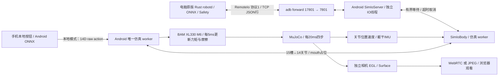

# M9：BAM 执行器与 Rust SimIo 身体服务

当前版本 `0.9.0-m9` / versionCode=17，手机标题 `Microduck · Android M9`。用户继续通过 Android Studio 编译、安装、运行，Gradle JDK 为 JBR 17.0.14，Java 源码/输出兼容级别11。PDF按用户要求保持上次快照。

## 两项如何组合

Android 原生层实现了 BAM M6 / XL330，复现上游 CPU MuJoCo BAM 的电压控制、反电动势、负载相关摩擦、Stribeck 摩擦、转子等效惯量及电压下垂。手机本地按钮仍用 Android ONNX 策略；开启身体服务后，由桌面原版 Rust `robotd` 接管策略、控制与安全逻辑，Android 接收关节目标并推进 MuJoCo。

这一阶段选择 **SimIo 身体服务** 路线。Rust 核心运行在电脑，APK没有新增Cargo编译或嵌入Rust daemon；新增的C++ BAM随原有NDK/JNI编译。两个Pollen仓库的源码无需修改。



## 手机上直接使用 BAM

1. 在Studio Build/Run，确认M9。
2. “BAM XL330 执行器”默认勾选。点“策略站立”“前进”或“向前翻滚一次”即可使用新执行器。
3. 取消该复选框可切回原XML执行器；切换会暂停、关闭策略并复位SIT，随后重新点策略按钮。不要在两种物理模型之间直接沿用旧的运行状态。
4. “按桌面运行时过滤动作”仍是独立选项。当前保留头`.5`、腿`.7`，可关闭对照；开启BAM没有隐式修改策略或动作滤波。

原来的局域网4位访问码、独立相机及WebRTC/JPEG仍可使用。BAM不是“让动作一定更灵活”的补丁；抬头速度、动作自然程度仍需设备观察。

## 电脑 Rust 控制手机身体

手机保持前台、选择BAM，点击“开启 Rust 身体服务”。服务只监听手机 `127.0.0.1:7801`；协议兼容原版Rust，没有新增token字段，因此通过USB的adb forward连接，不直接暴露到Wi-Fi。HTTP 8080配对和相机观看仍按原方式工作。

在电脑的 `android-sim` 目录执行：

```bash
adb devices -l
adb -s <仿真手机SERIAL> forward tcp:17801 tcp:7801
python3 scripts/android_robotd.py run
```

保持这个终端运行，在另一个终端执行：

```bash
cd /Users/navinfo/AndroidStudioProjects/deepLearning/microduck/android-sim
python3 scripts/android_robotd.py enable
python3 scripts/android_robotd.py walk --vx 0.3 --seconds 3
python3 scripts/android_robotd.py disable
```

`walk`默认vx=0.30m/s，与手机和网页前进按钮一致；因此也可直接运行 `python3 scripts/android_robotd.py walk --seconds 3`。这是速度指令，不保证实测速度等于0.30m/s。旧闭环记录已发现vx=0.15几乎不前进（`README.md:254`、`verification/host-policy-rehearsal.json:1`）；M9用户也确认Rust连接正常、0.30才能明显行走。显式传入0.15仍原样发送，脚本不会暗中放大速度。

`enable`发出上游`robot.enable`请求，坐姿启动交由sitstand策略起身；`walk`以10Hz持续发`robot.move`，结束时发送零速度。按Ctrl-C退出第一个终端中的robotd；Android观察到断线后暂停。

启动脚本复用已有 `Pollen/microduck/target/debug/robotd`，自动定位RL虚拟环境中的桌面ORT动态库，在 `/tmp/duck-android` 写本次params及socket。stand/walk/roulade使用Android当前三份模型；sitstand、ground_pick、左右kick使用 `Pollen/microduck/policies/` 的完整策略集。坐姿启动必须有`alpha_sitstand.onnx`。这些额外策略在电脑加载，不进入APK。首次没有桌面二进制时，在 `Pollen/microduck` 执行 `cargo build -p robotd`；此步骤与Studio的Android构建独立。

可通过 `--runtime-dir /tmp/另一个短目录` 隔离其他daemon，或通过 `run --body 127.0.0.1:其他转发端口` 改电脑端口。脚本不覆盖已有运行socket。清理USB转发：

```bash
adb -s <仿真手机SERIAL> forward --remove tcp:17801
```

## 控制权和断线行为

- 开启身体服务会暂停原运行、关闭Android策略。握手、读传感器、写目标本身不会释放身体；收到`torque:true`才开始按墙钟推进。
- 运行中的`torque:false`表示失去电机驱动力，身体继续受重力/接触/摩擦作用。TCP断线、空闲超时或协议错误则关闭力矩并暂停仿真。
- 重连后保持暂停；需要桌面再次明确启用。如果daemon仍记录已启用，可先`disable`，稍后再`enable`。
- 手机本地动作/暂停/复位按钮接管时会关闭身体服务。关闭服务后，桌面daemon不能再写入关节。
- 身体模式期间HTTP控制命令返回409，网页按钮禁用，状态与相机仍可查看。网页自动暂停请求也不能打断Rust控制；要接管请使用手机按钮或先关闭身体服务。
- Activity离开前台会暂停并关闭两类网络服务；回前台需重新手动开启。

## 协议与传感器

换行JSON，一请求一响应；一个客户端。第一条必须为 `{"op":"hello","protocol":1,"joints":15}`。

| 请求 | 实现 |
| --- | --- |
| `hello` | 核对版本1和15槽，返回`protocol:1` |
| `read` | 15槽位置rad、速度rad/s；躯干gyro、投影gravity、wxyz quaternion |
| `write` | 15个有限数字目标，忽略第9槽mouth；右腿从wire10映射到模型9 |
| `gain` | uint16固件kp；BAM直接用于PWM位置环，XML按kp/200缩放 |
| `torque` | 严格bool；开启时目标设为当前角，防旧目标跳变 |
| `slow` | 名义7.4V与15个32℃占位，带`simulated:true`，未实现电池/热仿真 |

不发送`currents_ma`：Rust按上游可选字段处理，`measures_load=false`，避免把假电流当负载测量。mouth位置/速度为0。没有实现`tofd`的ToF扩展或`mediad --sim-camera`；视频继续走Android的WebRTC/JPEG。

Socket读超时500ms、每行总期限1s、行上限4096字节；提交worker等待150ms，低于Rust RemoteIo的200ms请求超时。超时取消尚未执行的任务，关闭和本地接管由会话代数隔离旧请求。NativeSim及mjData始终只由一个仿真worker访问。

## BAM 参数和训练边界

参数及来源摘要固定在 [BAM.lock.json](BAM.lock.json)，来自BAM `mjlab_frictionloss` 分支提交`62bd8ce12154340be97e06f7f41a0ca8f116d967`；Apache-2.0许可和修改通知随APK的assets打包。

名义电压7.4V，下垂系数0.1、最低6V、固件基准kp200、无额外固件限流；目标每20ms更新，BAM每5ms在mj_step前更新。stand仍用kp160、walk/roll用200。力矩motor的forcerange按`7.4×kt/R`设置；XML的阻尼/摩擦由BAM更新，armature设为拟合值，摩擦约束参数与CPU复演一致。

这次对齐的是 **上游CPU BAM确定性复演**。训练还包含电压/摩擦/惯量随机化、3–6步执行器延迟及无EMA动作约定；当前Android没有移植这些随机化和延迟，也未宣称完整训练环境等价。参数中的`q_offset`为拟合台架偏差，上游CPU控制器不把它加到机器人关节目标，Android亦保持该行为。

## 关键代码

| file:line | 作用 |
| --- | --- |
| `app/src/main/cpp/bam_actuator.h:18` | PWM、电压与反电动势力矩 |
| `app/src/main/cpp/bam_actuator.h:22` | M6方向性/负载/Stribeck/二次摩擦 |
| `app/src/main/cpp/bam_actuator.h:49` | motor转换及XML参数恢复 |
| `app/src/main/cpp/bam_actuator.h:100` | 每物理步电压下垂和摩擦更新 |
| `app/src/main/cpp/native_sim.cpp:116` | wire15→model14的目标映射 |
| `app/src/main/cpp/native_sim.cpp:144` | model14→wire15及IMU传感器 |
| `app/src/main/java/com/microduck/sim/SimIoRequest.java:7` | 严格协议解析与数值校验 |
| `app/src/main/java/com/microduck/sim/SimIoServer.java:50` | IO线程到worker的有界请求 |
| `app/src/main/java/com/microduck/sim/SimIoBody.java:18` | 原生目标/增益/力矩与释放状态 |
| `app/src/main/java/com/microduck/sim/MainActivity.java:532` | 身体服务与本地控制权切换 |
| `scripts/android_robotd.py:1` | 原版Rust daemon启动及enable/walk命令 |

## 已完成的验证

- [m9-checks.json](verification/m9-checks.json)：JDK17/release11、真实Android34/ORT/WebRTC AAR Java编译，ARM64 JNI语法、原有XML/相机/HTTP回归、SimIo校验/单客户端/超时取消/断线、网页监看与控制隔离。
- [m9-bam-checks.json](verification/m9-bam-checks.json)：1000组公式误差约1.1e-16；与上游Python BAM逐步比较600步，最大误差约1.3e-13；BAM→XML恢复、复位和torque-off下落；真实ONNX站立5秒、步行5秒、翻滚2秒数值正常。翻滚投影累计约355.9°、最终倾角约1.18°，只支持这次HOME起始的主机结果。
- [m9-simio-checks.json](verification/m9-simio-checks.json)：直接编译上游sim.rs/io.rs/imu.rs，连接生产Java服务及真实JNI/MuJoCo/BAM；再运行本机已有完整robotd，启用后躯干约0.115m、默认前进指令运行3秒并检查前向位移超过0.05m，退出后暂停且力矩关闭。完整daemon按实际二进制SHA记录，不能用源码HEAD代替该二进制的构建来源。

以上自动化结果是主机检查。用户已确认M9 Rust连接测试通过，vx=0.30可见行走，反馈见 [user-M9-simio-feedback.json](verification/user-M9-simio-feedback.json)；低速跟踪、实测速度和动作质量尚未完成验证。性能、温升和30秒专项继续延期。PDF未更新。

主机新增检查命令（在android-sim；JDK路径和org.json JAR按本机实际位置替换）：

```bash
../Pollen/microduck_rl/.venv/bin/python scripts/check_bam.py \
  --java-home /Users/navinfo/Library/Java/JavaVirtualMachines/jbr-17.0.14/Contents/Home
python3 scripts/check_simio.py \
  --java-home /Users/navinfo/Library/Java/JavaVirtualMachines/jbr-17.0.14/Contents/Home \
  --mujoco-dir ../Pollen/microduck_rl/.venv/lib/python3.12/site-packages/mujoco \
  --host-json-jar <本机org.json.jar>
```

Rust测试crate仅供主机协议验证，APK不引用它。`check_simio.py`使用缓存的Cargo依赖离线编译，并在临时目录启动/关闭它自己创建的Java身体与robotd进程，不安装、启动或自动操作手机应用。
