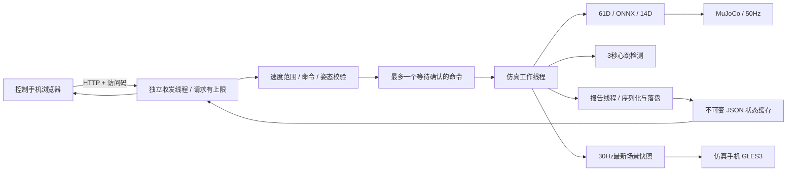

# M5.2：一台 Android 仿真，另一台浏览器观看和控制

当前源码版本为 `0.5.2-m52` / versionCode=9，手机标题 `Microduck · Android M5.2`，由用户在Android Studio构建/安装/运行。M5/M5.1视频功能已验证，但M5.1仍有1个22.613ms周期，配对记录落在元数据捕获/提交区间；见 [M5.1实测](verification/device-M51-video-acceptance.json)。M5.2把周期性元数据JSON组装移入报告线程、JPEG副本分配移出状态锁，并增加5段计时，检查 [verification/m52-checks.json](verification/m52-checks.json)，性能效果待测。使用及线程图见 [VIDEO.md](VIDEO.md)。

真实CAD视图仍由仿真手机以约30FPS绘制；浏览器默认关闭画面，勾选“开启实时画面”后按需采集、传输，目标10FPS、最大640×480。模型、ONNX、动作过滤及50Hz物理/策略沿用原基线。

## 双设备操作

1. 仿真手机用 Studio 运行新版，等模型、策略和3D加载完成。向下滚动，点击“开启局域网控制”。
2. 两台设备连接同一个 Wi-Fi，或由其中一台提供热点。应用显示地址及访问码；优先使用 Wi-Fi / 热点接口对应的地址，通常接口名为 `wlan0`。路由器若开启了客户端隔离，两台设备可能无法互相访问。
3. 控制手机浏览器打开显示的完整 `http://IP:8080/#token=...` 地址。复制包含片段的完整链接会自动填写访问码；只输入 `http://IP:8080/` 时，在页面粘贴仿真手机显示的访问码并点击连接。
   升级后重新加载页面，连接后可勾选“开启实时画面”；视频开启不启动仿真。真机视频验收步骤见 [VIDEO.md](VIDEO.md)。
4. 点击“策略站立”，应开始平衡；点击“前进0.30m/s”，应开始步行。网页每秒刷新仿真时间、位移、策略及控制耗时。状态来自最近发布的捕获对象，通常约250ms刷新一次。
5. 点击“暂停仿真”，手机停止物理推进。点击复位SIT/STAND/INIT，会暂停、关闭策略并复位关键帧；重新站立/前进可再次运行。
6. 浏览器切后台时尝试发送暂停；浏览器断开、Wi-Fi丢失或没有心跳超过3秒时，仿真手机自动暂停。网页恢复后需再次点击站立/前进，心跳本身不会启动仿真。
7. 仿真手机离开应用会暂停并关闭服务；回到应用后须重新点击“开启局域网控制”，使用新地址/访问码连接。手机上的本地控制按钮接管控制，已有网页心跳不会重新启动它。

速度改变保留当前姿态及策略历史；尚未启用策略时先放置HOME。自定义速度限制为 vx∈[−.30,.30]m/s、vy∈[−.15,.15]m/s、yaw∈[−.50,.50]rad/s；只有前进vx=.30已有手机闭环基准，其他方向需要单独观察验证。

服务由手机手动开启，默认关闭。访问码每次开启时重新生成，只在手机和控制页面使用，不写入普通状态、日志或验证报告。当前是同一局域网内的HTTP调试服务。

## 数据与线程



网络线程不访问原生句柄、MuJoCo模型/数据或ORT session。命令投递给仿真线程后才返回执行确认。排队命令1秒未完成返回504，尚未开始执行的命令被取消；已开始执行的操作不能因HTTP断开而回滚。命令处理需要依次执行，409表示本机实时测试占用控制，429表示已有命令等待确认。浏览器将请求串行化，避免自身心跳与控制指令争抢。

HTTP连接由2个收发线程及4个排队连接处理；请求头总量最多4096字节，命令体最多512字节，读取阶段截止时间2秒；从开始处理请求起总截止时间3秒，包含JPEG写出。服务仅实现当前页面所需的HTTP/1.1、固定路径及Content-Length请求，不支持chunked请求体、任意文件或跨域控制。视频与命令在网页中独立发起；每个页面最多一个图片请求。

普通状态缓存由报告线程更新，HTTP读取不触发JNI。报告增加 `running`、`lan_enabled`、`remote_control_active`、`remote_commands_applied`、`remote_stop_reason`；心跳不计入已执行控制命令数。`heartbeat_timeout`表示这次暂停由心跳超时触发。

## 接口与命令

| 请求 | 用途 | 访问码 |
| --- | --- | --- |
| `GET /` | 控制页面 | 页面可打开，连接时填写 |
| `GET /health` | 检查服务和协议版本 | 无 |
| `GET /api/state` | 最近状态JSON | `Authorization: Bearer <访问码>` |
| `GET /api/frame` | 最新JPEG；未就绪503 | 同上；访问码不放在URL中 |
| `POST /api/command` | 执行下表命令 | 同上；Content-Type为application/json |

| JSON | 行为 |
| --- | --- |
| `{"op":"stand"}` | 启用站立策略并运行 |
| `{"op":"walk","vx":0.30,"vy":0,"yaw":0}` | 设定速度并运行 |
| `{"op":"pause"}` | 暂停，释放远程控制 |
| `{"op":"reset","pose":"SIT"}` | 暂停、关闭策略、复位关键帧 |
| `{"op":"heartbeat"}` | 延长已有远程运行的心跳期限 |

本机“实时测试30s”期间拒绝远程控制命令，仍允许状态、图片读取与心跳；心跳不会干预测试，因为本机操作已释放远程控制。速度、额外字段或姿态不合法返回400；访问码不正确返回401，超限请求返回413/431。

## Mac 辅助排查

手机已手动开启服务后，可用ADB转发测试电脑到手机的TCP链路，第二台Android仍使用Wi-Fi地址：

```bash
adb -s 设备序列号 forward tcp:18080 tcp:8080
curl http://127.0.0.1:18080/health
# 清理这条转发
adb -s 设备序列号 forward --remove tcp:18080
```

需要命令行访问时，把应用显示的访问码放入 `DUCK_LAN_TOKEN`，目标根地址放入 `DUCK_LAN_URL`，然后执行：

```bash
curl -H "Authorization: Bearer $DUCK_LAN_TOKEN" "$DUCK_LAN_URL/api/state"
curl -H "Authorization: Bearer $DUCK_LAN_TOKEN" \
  -H 'Content-Type: application/json' \
  --data '{"op":"stand"}' "$DUCK_LAN_URL/api/command"
```

单次curl不会持续发送心跳，远程运行约3秒后将自动暂停；浏览器会持续发送心跳。

仅检查源码和Mac回环，不构建/安装APK：

```bash
# 在 android-sim 目录；host-json-jar 是测试专用 org.json，不加入 APK。
python3 scripts/check_source.py \
  --java-home /Library/Java/JavaVirtualMachines/jdk-11.jdk/Contents/Home \
  --android-sdk /Users/navinfo/Android/sdk \
  --ort-aar /private/tmp/microduck-onnxruntime-android-1.20.0.aar \
  --mujoco-dir ../Pollen/microduck_rl/.venv/lib/python3.12/site-packages/mujoco \
  --host-json-jar /绝对路径/json-20180813.jar
```

不传host-json-jar时仍执行编译检查，但不执行网络回环测试，并在报告明确标记。测试覆盖访问码、状态/命令、非法速度及字段、头/体上限、重复头、chunked拒绝、慢请求关闭、心跳时限、本地接管，以及超时排队命令取消。

## 已验证的M4基线与M5边界

- 已验证：用户确认浏览器连接及按钮功能正常；ADB报告显示M4、服务开启、已执行15条远程控制命令，应用日志包含远程运行及网页暂停；数值有限、GLES ready且无错误。报告 [device-M4-lan-state.json](verification/device-M4-lan-state.json)，验收来源及边界 [device-M4-lan-acceptance.json](verification/device-M4-lan-acceptance.json)。按钮为用户整体确认，未逐项保存独立断言；瞬时约29.84FPS不能替代30秒基准。
- 断连补测已通过：用户完成关闭控制端Wi-Fi测试，应用日志记录 `remote_stop_reason=heartbeat_timeout`、`running=false`、`remote_control_active=false`。租期配置3秒，实际Wi-Fi断开至暂停的时间没有单独计时；记录见 [device-M4-realtime-acceptance.json](verification/device-M4-realtime-acceptance.json)。关闭网页可能先触发主动暂停，`remote_pause`不能证明超时路径通过。
- 网络开启的30秒短实时测试已通过：[原始报告](verification/device-M4-realtime-render-test.json)为M4、LAN开启，墙钟30.006s/仿真30.02s、1501周期/6004步，约29.994FPS；控制+快照p99=15.186ms，完整工作线程p99=16.618ms/max=19.129ms，超20ms周期0、迟到周期0，最终位姿与M3.2完全一致。用户确认保持网页连接；报告未统计HTTP轮询次数。不同次测试未控制温度/频率，不能把耗时下降归因于网络改造。最大周期距20ms约0.871ms，本次结果不代表长期温升通过。
- 尚待验证：仿真应用前后台/重启后的服务关闭及新会话。应用回前台后须手动重新开启服务、使用新访问码，网页心跳不能恢复仿真。
- M5视频已采到576×480画面、30秒298发布帧/9.93FPS、268帧提供HTTP、错误0；完整工作线程预算未通过，见 [device-M5-video-acceptance.json](verification/device-M5-video-acceptance.json)。M5.1报告优化后须按 [VIDEO.md](VIDEO.md) 重测，仍待video-off/3D关闭对照、持续运行/温升。

当前targetSdk=34，新增INTERNET正常权限即可使用普通局域网socket；Android16的局域网限制为选择启用的测试功能。本工程没有开启该限制，也没有升级targetSdk。[Android官方局域网权限说明](https://developer.android.com/privacy-and-security/local-network-permission)、[网络连接权限说明](https://developer.android.com/develop/connectivity/network-ops/connecting)。

## 代码入口（当前行号）

| file:line | 作用 |
| --- | --- |
| `app/src/main/java/com/microduck/sim/MainActivity.java:430` | 开启服务、显示地址 |
| `app/src/main/java/com/microduck/sim/MainActivity.java:460` | 仿真线程执行命令及会话检查 |
| `app/src/main/java/com/microduck/sim/MainActivity.java:179` | 控制周期及心跳检查 |
| `app/src/main/java/com/microduck/sim/MainActivity.java:493` | 退出前台时关闭 |
| `app/src/main/java/com/microduck/sim/LanControlServer.java:28` | Socket、线程与请求边界 |
| `app/src/main/java/com/microduck/sim/LanControlServer.java:87` | HTTP路径、授权和命令路由 |
| `app/src/main/java/com/microduck/sim/RemoteCommand.java:7` | 命令验证 |
| `app/src/main/java/com/microduck/sim/RemoteMailbox.java:12` | 等待确认与超时取消 |
| `app/src/main/java/com/microduck/sim/RemoteLease.java:4` | 心跳/控制归属 |
| `app/src/main/assets/controller.html:38` | 浏览器画面、状态和心跳 |
| `verification/NetworkControlCheck.java:1` | 回环与协议检查 |
| `verification/m52-checks.json:1` | 当前检查结果及源码摘要 |
