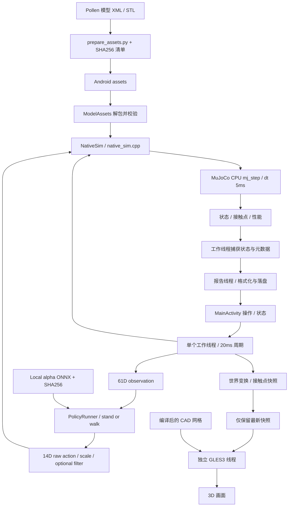

# Android Studio 施工入口（M8：独立机器人相机 + WebRTC）

在 Android Studio 中打开当前目录 `android-sim`，不要打开外层 Microduck 目录。由你完成 Sync、编译、安装和真机运行。

首次从 GitHub 获取时，先按 [DEPENDENCIES.md](DEPENDENCIES.md) 准备外部源码和已验证策略；固定提交及资源摘要见 [UPSTREAM.lock.json](UPSTREAM.lock.json)。

当前实现是 **Android arm64 上的 MuJoCo + ONNX + 3D 测试应用**：加载桌面 duck-body 使用的 `scene.xml → robot_groundcontact.xml`，保留 M1/M2 测试、真实 CAD 网格视图和按墙钟运行的30秒测试。另一台Android浏览器可发站立/步行/前滚翻/暂停/复位命令并读状态；视频来自模型的 `head_camera`，随机器人头部运动。手机保留外部观察视角。控制见 [NETWORK.md](NETWORK.md)，相机见 [VIDEO.md](VIDEO.md)，前滚翻见 [SKILLS.md](SKILLS.md)。

**当前功能开发 M8：** `0.8.0-m8` / versionCode=15，标题 `Microduck · Android M8`。机器人相机拥有独立 EGL 上下文和 Surface，关闭手机“显示3D”后仍能出流。网页新增 WebRTC（目标20FPS、优先H.264硬件编码、单观看者）与JPEG兼容模式（640×360、10FPS、质量70）。在Studio重新Sync、Build、Run，保持应用前台，开启LAN并刷新控制网页；勾选“开启机器人摄像头”，可关闭手机3D并观察视频是否继续。保留站立/步行、2秒翻滚、滤波、伺服及50Hz控制基线，抬头慢/僵硬未在这次改动中修复。视频方案、架构和功能验收见 [VIDEO.md](VIDEO.md)。

**详细技术说明：** [PDF](docs/Android_Microduck_方案架构与编译复用说明.pdf) / [Markdown](docs/Android_Microduck_方案架构与编译复用说明.md)，重点说明Android与两个Pollen仓库的资源复用、构建边界、NDK引擎编译、训练BAM差异，并包含架构图、关键源码注解、依赖及使用方法。生成与源码引用检查见 [docs/README.md](docs/README.md)。

**检查边界：** [verification/m8-checks.json](verification/m8-checks.json)验证实际WebRTC AAR/JDK11 Java编译、JNI/物理/相机对照、动作窗口及网页/HTTP协议，增加信令大小、会话替换、迟到回调、关闭与offer乱序检查。依赖AAR、arm64库及原AGP7.2.2 D8的转换检查见 [m8-video-dependencies.json](verification/m8-video-dependencies.json)。M8完整APK编译及WebRTC设备功能尚待用户Studio确认。用户已确认M7摄像头正常、M7.1整圈翻滚通过，反馈抬头慢、整体动作僵硬；只读手机日志证据见 [device-M71-roll-acceptance.json](verification/device-M71-roll-acceptance.json)。采样未见推理瓶颈，主机对照发现交接时头颈恢复不同步、视线先向下再恢复；关闭恢复阶段头部滤波仅小幅改善，诊断见 [SKILLS.md](SKILLS.md)。当前保留已通过的2秒配置，不宣称任意起始姿态成功或动作质量已修复。代理未打包/安装/运行APK。性能、温升及前后台验收按用户要求延期。下面M5/M5.4数据是外部观察窗口画面的历史结果。

**历史M5.4视频开启30秒验收通过：** `0.5.4-m54` / versionCode=11。1501周期/6004物理步、墙钟30.007秒/仿真30.02秒，完整工作线程p99=10.648ms/max=19.772ms、超20ms周期0，调度迟到超过20ms周期0；手机30.03FPS、视频298发布帧/9.93FPS、265帧提供HTTP、采集错误0，数值及最终位姿与M5.3一致。报告捕获平均0.285ms/max=0.519ms，队列提交max=0.087ms。证据 [verification/device-M54-video-acceptance.json](verification/device-M54-video-acceptance.json)。单次最大预算余量0.228ms，温度/频率未控制，不代表长期或硬实时保证。

**M5.4视频关闭对照也通过：** LAN及手机3D保持开启，30秒新增视频发布/HTTP帧均为0、观看需求和在途复制均为false。工作线程p99=15.587ms/max=19.699ms、超20ms周期0，手机29.99FPS，最终位置/四元数与视频开启时完全一致。证据 [verification/device-M54-video-off-acceptance.json](verification/device-M54-video-off-acceptance.json)。关闭后的p99较高，温度/CPU频率未控制，不能用这一对测试确定视频开关的成本。视频会话和累计计数不归零是正常行为。

**性能和前后台验收已延期：** 用户2026-10-04要求继续功能开发，后续再测。M5.4源码检查 [verification/m54-checks.json](verification/m54-checks.json)和两份实测归档保留。

**M5.3复测结果：** 30秒发布297帧/9.90FPS、提供HTTP263帧、采集错误0，手机30.03FPS；工作线程p99=12.557ms/max=20.369ms，2周期超20ms、迟到周期0。两个配对样本的唤醒墙钟11.348/14.834ms，提交区间线程CPU仅0.137/0.167ms，准入与队列发布各约0.01ms。说明提交区间CPU消耗很低，但不能区分系统调度、GC或内核等待；见 [verification/device-M53-video-acceptance.json](verification/device-M53-video-acceptance.json)。M5.4针对该唤醒路径改动。

**M5.2复测结果：** 30秒发布297帧/9.90FPS、提供HTTP269帧、采集错误0，手机约30FPS；仍有1周期21.270ms。该周期应用/渲染/视频/策略捕获合计0.144ms，报告队列提交区间12.545ms。区间包含任务构造、队列提交及线程唤醒，不能仅凭它证明锁等待。证据 [verification/device-M52-video-acceptance.json](verification/device-M52-video-acceptance.json)。

**M5.1复测结果：** 30秒发布298帧/9.93FPS，提供HTTP271帧，采集错误0、手机约30FPS。报告捕获平均1.312ms（前次M5为2.721ms），但工作线程仍有1周期22.613ms；配对记录为控制+快照4.533ms、原生状态0.162ms、元数据捕获/提交17.879ms。预算未全部通过，且该区间内部原因尚不能区分分配/调度/锁等待。证据 [verification/device-M51-video-acceptance.json](verification/device-M51-video-acceptance.json)。

**M5视频功能已验证，完整工作线程预算未通过：** 用户完成浏览器视频/按钮和30秒测试；手机576×480采集、发布298帧/9.93FPS、提供给HTTP发送器268帧、采集错误0，手机渲染约30FPS。控制+快照max=14.736ms，但完整工作线程max=22.422ms、超20ms周期3；不能判定全部周期达标。原始报告 [verification/device-M5-video-on-realtime-test.json](verification/device-M5-video-on-realtime-test.json)，对比 [verification/device-M5-video-acceptance.json](verification/device-M5-video-acceptance.json)。不同次温度/频率未控制，不能据p99下降归因于视频改造。

**已通过的M4基线：** 浏览器按钮、断连心跳超时暂停、网络开启的30秒测试均通过；工作线程p99=16.618ms/max=19.129ms、超20ms和迟到周期0、约30FPS，见 [verification/device-M4-realtime-acceptance.json](verification/device-M4-realtime-acceptance.json)。不能用此结果代替M5视频测试。前后台会话、持续运行/温升及3D关闭对照仍待测。

## 在 Android Studio 编译

1. File → Open，选择 `/Users/navinfo/AndroidStudioProjects/deepLearning/microduck/android-sim`。
2. Settings → Build, Execution, Deployment → Build Tools → Gradle，使用工程自带 Gradle Wrapper；Gradle JDK 选择 **JDK 11**。当前机器可选择 `/Applications/Android Studio.app/Contents/jbr/Contents/Home`（本机这个目录是 JDK 11；其他机器请核实版本）。
3. SDK Manager 安装 Android SDK Platform 34、NDK **25.1.8937393**、CMake **3.30.3**。当前 `local.properties` 指向 `/Users/navinfo/Android/sdk`；换机器应让 Studio 更新 SDK 路径。
4. 执行 Gradle Sync，首次同步保持网络可用。配置为 AGP 7.2.2 / Gradle 7.5，不必在首次验收时顺带升级构建链。
5. 选择 `app` 和你的 ARM64 Android 设备，点击 Run。最低 Android API 28；本次目标设备为 V2185A / Android 16 / 骁龙 SM8450。

构建会自动执行 `scripts/prepare_assets.py`，从旁边的 `Pollen/microduck_rl` 收集 XML 与 38 个 STL，从 `Pollen/microduck/policies` 收集 `alpha_stand.onnx / alpha_walking.onnx / roulade.onnx`，并生成 SHA-256 清单。因此需要保留当前目录与 `Pollen` 的相对位置，以及 PATH 中可用的 **Python 3.9+**、Git。若 Studio 报找不到 `python3`，从终端运行 `python3 scripts/prepare_assets.py` 确认解释器可用，并修正启动 Studio 时的 PATH。

M2 新增 Maven 依赖 `com.microsoft.onnxruntime:onnxruntime-android:1.20.0`，再次 Sync 会下载它。已检查实际 AAR 的 Java 类版本兼容 JDK 11，因此构建链维持不变。当前目标手机的系统页大小为 4096 字节；该 AAR 的 JNI 库仅有 4KB ELF 对齐，16KB 页设备尚不支持当前组合，不能凭 MuJoCo 库的 16KB 对齐宣称整个 APK 已支持。

**M8新增依赖：** `io.getstream:stream-webrtc-android:1.3.9`，首次Sync下载AAR及Kotlin stdlib1.9.25/AndroidX annotation1.9.1。AndroidX已启用；JDK11、AGP7.2.2、Gradle7.5保持。AAR字节码major55、minSdk21，arm64 JNI为16KB对齐；ORT的4KB限制仍在。固定来源与摘要 [VIDEO_DEPENDENCIES.lock.json](VIDEO_DEPENDENCIES.lock.json)，通知/许可见 `app/src/main/assets/licenses/`。

CMake 会从源码构建 MuJoCo 和 JNI 库，不需要手动复制 `.so`。MuJoCo 固定为 3.10.0，提交 `28009f9105cd92784b7b0b30c0605a5e29107a77`。本机已准备 `.native-cache` 源码缓存；缓存缺失时构建配置会下载官方源码及上游固定版本依赖。缓存和生成模型不提交到版本控制。

## 手机上怎么验收

**保留的 M3 实时验收：**

1. 下面是保留的性能测试方法，用户已将其延期；M8功能验收先按 [VIDEO.md](VIDEO.md) 完成，无需重跑30秒测试。
2. 上方应出现真实机器人 CAD 外观及地面网格。单指拖动旋转视角，双指缩放；“复位视角”恢复默认角度和距离。“跟随机器人”保持机器人在中心，取消后可以观察它在地面上的位移。
3. 点击“策略站立”观察平衡；点击“前进 0.30m/s”观察脚步。橙线是最近约 512 个绘制快照的地面轨迹，红点是 MuJoCo 当前接触点，可以关闭接触点显示。
4. 等 3D 正常显示后，点击“实时测试 30s”。从 HOME 重置，发送 vx=.30，按 50Hz 运行 30 秒墙钟，然后自动暂停。保持应用在前台且不再点击重置；告诉 Codex 完成，以便经 ADB 获取报告。
5. 报告 `mode=realtime_render_test`，包含墙钟/仿真时间比例、控制周期与快照的 p95/p99/max、超过 20ms 的周期数、调度迟到及绘制帧率。本版画面目标约 **30FPS**，物理与推理仍是 **50Hz**；不要用原 M3 的 53.74FPS 作为新版本帧率目标。
6. 先导出开启 3D 的报告，再关闭“显示3D”重复实时测试并另存。关闭时绘制回调应接近零。同类新测试会覆盖独立归档；暂停后转动相机也会请求额外绘制，因此测速期间勿操作相机。

```bash
# 开启 3D 的测试结束后，先执行第一条；关闭 3D 再测后，执行第二条。
adb shell run-as com.microduck.sim cat files/last-realtime-test.json > /tmp/microduck-m32-3d-on.json
adb shell run-as com.microduck.sim cat files/last-realtime-test.json > /tmp/microduck-m32-3d-off.json
```

保留默认动作过滤设置，关注数值有限、高度、最终位移，以及 `control_with_visual_p99_ms`、`worker_tick_p99_ms`、`worker_over_20ms_ticks`、`late_ticks`。M3.2手机工作线程p99=18.085ms/max=19.923ms；M4网络开启时p99=16.618ms/max=19.129ms，超20ms周期0。两次最终x=3.501m/y=-1.225m/z=.1198m相同；温度/频率未控制，不据此推断性能提升原因。

原来的“策略测试 10s”仍是不等待墙钟的 M2 快速计算基准，不能用来观看完整动画：循环中不逐步更新画面，只显示开始和结束姿态。看步行应使用“前进”或“实时测试30s”。

**保留的 M2 操作：**

1. 加载两份策略时会核验 SHA-256、float32 输入 `[1,61]`、输出 `[1,14]`，并执行四组桌面 ONNX 对照；最大绝对误差超过 0.001 会拒绝加载策略。M1 操作仍可用。
2. 点击“策略站立”：从 HOME 放置开始（躯干 0.125m、关节 home、速度/原始动作反馈归零），50Hz 推理。点击暂停后查看高度、位移与数值。
3. 点击“前进 0.30m/s”：选择步行策略。已启用策略时只改变速度命令，保留机器人状态；尚未启用时先重置 HOME。
4. 点击“策略测试 10s”：总是从 HOME 重置，发送 vx=0.30m/s，执行 500 个控制周期，每次推理后推进四个物理步。结束保持暂停，读取位移、姿态和周期 p95/p99/max；这测的是 10 秒**仿真时间**，不等待 10 秒墙钟。
5. 完成后告诉 Codex，可经 ADB 读取 `last-report.json`。不要在读取前再重置姿态，否则会覆盖测试报告。

**原有 M1 操作：**

1. 等待模型校验完成，初始为 `SIT` 且暂停。应显示 `body=16 / nq=21 / nv=20 / actuator=14 / mesh=38 / dt=0.005s`。
2. 点击“步进 20ms”：仿真时间每次增加 0.020 秒，即执行四次 `mj_step`。
3. 点击“运行”，观察仿真时间持续增加，有限数值和脚底匹配均为 `true`；“暂停”停止推进。离开 Activity 会暂停，返回后需点击运行。
4. 点击“基准测试 2000 步”：重置当前姿态，暖机 100 步，再测 2000 步。结束时仿真时间约 10.5 秒，显示物理实时倍率及单步 p50/p95/p99。
5. 可以分别重置到 `SIT`、`STAND`、`INIT` 重复测试。没有平衡策略时 `STAND` 可能倒下；这不等同于步行策略失败。M1 验收关注模型加载、推进、数值稳定和物理性能。

左右脚接触数来自 MuJoCo 接触列表中 `left_foot_collision / right_foot_collision` 与 `floor` 的 geom 配对，表示接触点数量，不表示力或训练奖励。

性能数字只覆盖当前位置伺服的物理测试。`last_batch_ms` 包含四次物理推进及数值检查，不包含最终 `mj_forward`、JNI 返回、JSON、文件写入和 UI 更新；基准也不包含 ONNX、渲染、视频。不能用这个数字宣称整套系统已达到实时要求。

策略模式另报 `inference_ms` 和 `control_ms`。M3.1 的后者包括观测 JNI、ONNX、动作 JNI、物理推进及 `mj_forward`，不再包含原生状态 JSON（原 M3 包含），也不包含报告落盘与 UI 更新。策略基准没有墙钟节拍，仍需另做实时运行、温升和持续性测试。

M3 的 `control_with_visual_ms` 及实时测试分位数包含额外的场景快照构造/JNI 拷贝/请求绘制。GPU 在独立 GL 线程工作，不在该计时范围；`render_cpu_ms` 是 GL 回调内的 CPU 提交时间，既不含之后的 EGL swap，也不是 GPU 完成耗时。`test_render_fps` 是实际执行的绘制回调数量/测试墙钟时间，不等于屏幕面板刷新率。

M3.1 起增加各项 p95/p99/max：`policy_tick_*`（观测→推理→动作）、`physics_advance_*`（4 步及 forward）、`visual_snapshot_*`（未取快照的周期为零）、`worker_tick_*`（整个工作线程回调）。M3.1 的 `worker_tick_*` 包含当次文件、日志和 UI 准备；M3.2 把这些移到报告线程，仅包含状态捕获和队列提交。`publish_mean_ms / publish_max_ms` 也改为捕获/提交成本。原 `control_over_20ms_ticks` 不包含发布成本，新的 `worker_over_20ms_ticks` 包含当版在控制线程上的发布成本；两者均不包含 GPU 完成、EGL swap 或 UI 实际绘制。

## M3 渲染机制

MuJoCo 传统渲染器调用桌面 OpenGL 的兼容接口，Android 提供 OpenGL ES，因此本工程没有直接调用 `mjr_render`。JNI 从已编译的模型导出真实 mesh 顶点/法线；Java `GLSurfaceView` 用 GLES3 绘制。当前模型有 38 个独立网格（431,802 个三角形），被 70 个可视 geom 引用。M3.1 按“顶点索引+法线索引”共享渲染顶点，保留棱角、全部三角形及原顺序，使用 `glDrawElements / GL_UNSIGNED_INT`。215,317 个共享顶点及索引合计 10,349,232 字节（9.87MiB），原逐三角形展开为 31,089,744 字节（29.65MiB），数据量减少约 66.71%；这不等同于 GPU 内存总量或实测性能降幅。静态数据每个 GL context 上传一次，丢失 context 后用保留的 CPU 数据重建。

所有 `mjModel/mjData` 访问仍在仿真工作线程；物理/策略保持 50Hz，通过墙钟门限平均 30Hz 拷贝 geom 的世界位置、旋转、颜色和接触点。50Hz 控制周期下相邻快照通常间隔 20ms 或 40ms，未做姿态插值；相机操作、重置、测试完成仍可主动刷新。GL 线程只读不可变快照，没有原生仿真句柄。仅保留最新快照并按需绘制，慢画面不会积累无界队列；场景导出与画面线程都不推进物理。

连续控制使用 `NativeSim.advance`，保留原四步 `mj_step`、数值检查及最终 `mj_forward`，每约 250ms 捕获一次状态 JSON。定期发布复用已有画面，不再重复取快照；单步、重置及完成测试提交新状态。

M3.2 在工作线程上捕获原生状态、策略及渲染元数据后，交给独立 `ReportDispatcher` 线程进行 JSON 格式化、文件写入、日志和 UI 文案准备。报告线程只读这份独占的捕获对象，不访问 `mjModel/mjData`、策略 session 或工作线程的可变字段。普通状态只保留最新一份待处理任务，完成的测试按序保存，销毁 Activity 时排空已接受任务；UI 投递仍检查 Activity 是否已销毁。若报告保存失败，错误被送回控制线程暂停仿真。

M3.1 真机已完成一次开启 3D 的 30 秒测试，报告见 `verification/device-M31-realtime-render-test.json`：画面 30.05FPS、控制加快照 p99=16.252ms/max=18.083ms，位姿与原 M3 报告相同。新增完整工作线程计时 p99=25.791ms/max=28.381ms、超20ms 76周期；发布平均9.243ms/max=13.206ms。因此下一步是把报告格式化、文件及日志移出控制线程。原 M3 未测这项总耗时，不能把76周期解释为新引入的退化。

以上瓶颈对应的 M3.2 已由用户重新构建并完成一次开启3D的30秒测试，报告见 `verification/device-M32-realtime-render-test.json`，对比见 `verification/device-M32-comparison.json`；源码检查见 `verification/m32-checks.json`。

| 指标 | M3.1 | M3.2 |
| --- | ---: | ---: |
| 工作线程 p99 | 25.791ms | 18.085ms |
| 工作线程最大耗时 | 28.381ms | 19.923ms |
| 工作线程超过20ms周期 | 76 | 0 |
| 工作线程上的发布平均耗时 | 9.243ms | 3.254ms |
| 测试绘制回调帧率 | 30.05FPS | 30.02FPS |

M3.2 仿真30.02s/墙钟30.013s，调度迟到超过20ms为0，全部数值正常、无GL错误；最终位置/姿态与前两版报告相同。这次完整工作线程p99下降约29.88%，30秒控制预算验收通过，但最大周期距离20ms余量约0.077ms，且两次运行未控制温度和CPU频率，不能据此保证长期稳定。仍需3D关闭对照及后续持续运行测试。M3.2发布耗时只计控制线程的捕获/提交，异步报告I/O耗时不在其中。

## 源码检查（不打包或安装 APK）

已验证的检查见 `verification/m31-checks.json` 和当前 `verification/m32-checks.json`：Java/JNI 编译检查、全部三角形展开后的位置和法线一致、棱角/平面法线保留、500周期物理推进与旧流程完全一致、30FPS门限在50Hz及抖动时钟下无累计漂移或补帧队列。M3.2 增加慢报告不阻塞提交、普通状态合并、测试归档不丢、关闭排空和错误后继续处理的队列测试。

Mac 上可重复执行；下面路径对应本机环境，其他机器按实际位置修改。ORT AAR 可使用 Gradle 已下载的1.20.0文件；MuJoCo目录是桌面Python包，不是Android源码缓存。

```bash
# 在 android-sim 目录执行；先准备好模型 assets。
python3 scripts/check_source.py \
  --java-home /Library/Java/JavaVirtualMachines/jdk-11.jdk/Contents/Home \
  --android-sdk /Users/navinfo/Android/sdk \
  --ort-aar /private/tmp/microduck-onnxruntime-android-1.20.0.aar \
  --webrtc-aar /private/tmp/microduck-webrtc-stream-1.3.9.aar \
  --mujoco-dir ../Pollen/microduck_rl/.venv/lib/python3.12/site-packages/mujoco
```

当前绘制视觉 mesh（group<3），不显示碰撞几何；采用模型材质颜色和简化光照。地面是与当前场景水平 floor 对齐的程序网格，不复制桌面纹理、阴影或完整材质。M6曾在同一GLES线程另行渲染 `head_camera` 的640×360离屏帧，只绘制场景，不加入调试轨迹/接触点。该视角与手机观察视角独立，仍使用简化材质/地面，尚未完全复制桌面MuJoCo画面效果。原M5窗口PixelCopy链路已被相机FBO替换；M5.4两次30秒结果保留为历史基线。

## 61D / 14D 接线约定

观测：`gyro[3] + gravity[3] + (q-home)[14] + qvel[14] + previous_raw_action[14] + command[13]`。Free joint 的角速度直接作为躯干局部 gyro；投影重力为 `Rᵀ × [0,0,-1]`。关节按名字定位 qpos/qvel/actuator，不假设数组偏移。命令依次为 twist(3)、head(4)、body(6)，body x/y/yaw 强制零。

命令模长 `<0.05` 用 stand，其余用 walk；目标为 `HOME + scale × raw_action`，stand scale=1.0/gain=160，walk scale=0.9/gain=200。XML 增益按 gain/200 缩放。原始 action 写回下一帧观测，不把目标角或滤波结果写回。

过滤复选框默认采用 Rust `Tuning::default` 的目标 EMA：头 alpha=0.5、腿 alpha=0.7，第一帧不滤波；可以关闭做 A/B。训练仓库要求无 action low-pass，与运行时存在差异，所以这里明确记录设置，不声称与训练物理完全一致。没有对头目标再加一次命令，也没有额外观测归一化；现有 ONNX 自带 normalizer。

这是桌面 duck-body 的 **XML 位置伺服**路径，不是训练用 BAM M6。未移植 Rust 的完整 Safety、调度、skill、command EMA 或参数覆盖，仅在仿真内测试，不能直接控制实物机器人。

换 ONNX 后要重新生成桌面对照，不能只更新 manifest：

```bash
# 在工作区外层目录执行
python3 android-sim/scripts/prepare_assets.py
Pollen/microduck_rl/.venv/bin/python android-sim/scripts/policy_rehearsal.py
```

脚本会重建 `policies/smoke.json`、倾斜运动状态的观测测试夹具及桌面闭环报告。

## 导出测试结果

调试版安装后，在 Mac 终端执行：

```bash
adb shell run-as com.microduck.sim cat files/last-report.json
adb logcat -s MicroduckM1
```

`last-report.json` 每次显示状态都会更新；要保留基准结果，在测试完成后立即导出，或保持暂停。连接两台设备时给 adb 增加 `-s 设备序列号`。

后续修订增加独立测试归档，下一次构建起生效：`last-realtime-test.json`、`last-policy-benchmark.json`、`last-physics-benchmark.json`。普通状态、姿态重置及 Activity 重建不再覆盖这些文件，仅同类新测试覆盖旧结果。例如 `adb shell run-as com.microduck.sim cat files/last-realtime-test.json`。

也可以直接启动指定姿态的基准测试：

```bash
adb shell am force-stop com.microduck.sim
adb shell am start -n com.microduck.sim/.MainActivity --es keyframe SIT --ei benchmark_steps 2000
```

如需命令行构建，已有 `scripts/build.sh`；你使用 Studio 时不需要执行它。Debug APK 的标准输出位置为 `app/build/outputs/apk/debug/app-debug.apk`。

## 代码入口与构建边界



| 文件 | 作用 |
| --- | --- |
| `app/build.gradle` | SDK/NDK、CMake 构建和模型生成任务 |
| `app/src/main/cpp/CMakeLists.txt` | 固定 MuJoCo 版本、依赖、兼容补丁、16KB ELF 段对齐 |
| `patches/mujoco-3.10.0-ndk25.patch` | 将 XML 解析处的 string_view 迭代器构造改为同范围的指针+长度构造，适配 NDK25 libc++ |
| `app/src/main/cpp/native_sim.cpp` | 模型生命周期、关键帧、推进、有限数检查、接触配对和计时 |
| `app/src/main/cpp/visual_snapshot.h` | 编译网格导出、世界坐标变换/颜色/接触点快照 |
| `app/src/main/java/com/microduck/sim/NativeSim.java` | JNI 接口及库加载 |
| `app/src/main/java/com/microduck/sim/MainActivity.java` | 工作线程调度、操作按钮、JSON 结果和日志 |
| `app/src/main/java/com/microduck/sim/ModelAssets.java` | 保留模型相对路径、校验并解包资源 |
| `app/src/main/java/com/microduck/sim/PolicyRunner.java` | CPU 单线程 ONNX、尺寸/校验/桌面对照、网络选择和 raw action 反馈 |
| `app/src/main/java/com/microduck/sim/SceneFrame.java` | 快照校验与 MuJoCo/GLES 矩阵转换 |
| `app/src/main/java/com/microduck/sim/RobotSurfaceView.java` | GLES3、相机手势、轨迹、接触点、GPU context 生命周期 |
| `app/src/main/java/com/microduck/sim/HeadCamera.java` | 模型头部相机姿态、视场角、裁剪平面及视图矩阵 |
| `app/src/main/java/com/microduck/sim/CameraPixels.java` | GLES RGBA读回到Android ARGB的上下翻转/通道转换 |
| `app/src/main/java/com/microduck/sim/VisualMesh.java` | 索引网格包、长度/索引/有限数校验 |
| `app/src/main/java/com/microduck/sim/VisualCadence.java` | 50Hz控制下的30Hz墙钟快照门限 |
| `app/src/main/java/com/microduck/sim/ReportDispatcher.java` | 独立报告线程、状态合并、完成测试保留 |
| `app/src/main/java/com/microduck/sim/CapturedReport.java` | 捕获元数据、报告线程解析并合并原生JSON |
| `app/src/main/java/com/microduck/sim/LanControlServer.java` | 局域网HTTP页面、访问码、请求边界、状态读取 |
| `app/src/main/java/com/microduck/sim/RemoteCommand.java` | 命令和速度范围校验 |
| `app/src/main/java/com/microduck/sim/RemoteMailbox.java` | 单个等待确认命令、排队超时取消 |
| `app/src/main/java/com/microduck/sim/RemoteLease.java` | 3秒心跳与本地接管 |
| `app/src/main/java/com/microduck/sim/VideoCapture.java` | 按需SurfaceView采集、独立线程JPEG编码 |
| `app/src/main/java/com/microduck/sim/VideoFrames.java` | 单帧缓存、单个采集、时限和会话关闭 |
| `app/src/main/assets/controller.html` | 第二台Android的浏览器控制页面 |
| `app/src/main/java/com/microduck/sim/SceneRenderer.java` | 预览/相机共同绘制实现，各实例独立GPU资源 |
| `app/src/main/java/com/microduck/sim/CameraScene.java` | 两路GL共享的CPU不可变快照 |
| `app/src/main/java/com/microduck/sim/RtcVideo.java` | 单peer、H.264优先硬件编码、stats与原生寿命 |
| `app/src/main/java/com/microduck/sim/RtcSession.java` | 有界信令、generation、8秒租期与取消id |
| `VIDEO_DEPENDENCIES.lock.json` | WebRTC AAR/传递依赖的固定来源与摘要 |
| `scripts/check_video_dependencies.py` | 实际AAR/ELF及AGP原D8的依赖兼容检查 |
| `scripts/check_source.py` | Mac源码检查及带摘要的报告；不运行Gradle或安装APK |
| `scripts/host_baseline.py` | 桌面物理基线，结果见 `verification/host-baseline.json` |
| `scripts/policy_rehearsal.py` | ONNX 对照、观测夹具、过滤开关与速度命令的闭环预演 |
| `verification/native-contract-check.cpp` | 直接测试 Android JNI 调用的 C++ 观测/动作函数 |
| `scripts/visual_reference.py` | 使用 CPU mjv_updateScene 生成渲染桥参考，不需要 GL |
| `verification/visual-bridge-check.cpp` | 与 MuJoCo 可视化场景核对快照及网格顶点 |
| `verification/SceneFrameCheck.java` | Java 矩阵映射及非法快照拒绝测试 |

## 已验证与待验证

- 已完成 Android arm64 原生库的编译；现有 ELF 检查确认 JNI 库为 AArch64，依赖 `libmujoco.so`，LOAD 段采用 16KB 对齐。
- 桌面 MuJoCo 3.10.0 对三种关键帧各推进 2100 步，数值有限；模型维度符合上述预期。桌面速度不能代表手机速度。
- M1 已由用户 Studio 编译并在 V2185A 运行，三组物理基准为 22.27–23.67×，结果见 `verification/device-benchmark-summary.json`。
- M2 Java 源码对实际 ORT 1.20.0 AAR 通过 JDK 11 编译检查，JNI 通过 Android ARM64 编译器语法检查；未执行 M2 Gradle 打包、安装或启动，交由用户 Studio 完成。
- C++ 观测在包含倾斜、角速度、关节速度及非零命令的夹具上与 Python MuJoCo 参考逐项一致；动作缩放、目标过滤、增益和 NaN 拒绝通过测试，见 `verification/m2-checks.json`。
- 桌面闭环：站立 10 秒保持约 0.116m 高；vx=0.15 几乎未前进，vx=0.30/过滤开前进约 1.20m、横向漂移约 -0.22m、最终高度约 0.120m。过滤关闭也完成预演。详见 `verification/host-policy-rehearsal.json`；尚不代表手机步行已通过。
- M2 手机短基准已完成：500 周期/10 秒仿真，耗时 0.540 秒（18.51×），控制周期 p99=1.727ms、max=3.023ms；ONNX 对照误差约 6.71e-8。最终 x=1.207m、y=-0.230m、z=0.1193m，数值有限。与桌面最终坐标差约 +2.7/-8.8/-0.84mm，不能据此宣称整条轨迹完全一致。报告见 `verification/device-M2-policy-benchmark.json`，比较见 `verification/device-M2-comparison.json`。
- M3 静态与接口检查通过：Java 对 Android34/ORT AAR 编译检查通过，Android ARM64 JNI 语法检查通过。倾斜运动状态下，38 网格/70 部件的快照与 CPU `mjv_updateScene` 参考误差为 0；法线/顶点有限，Java 矩阵转换和非法快照拒绝测试通过。记录见 `verification/m3-checks.json`。
- M3 尚未由代理打包、安装或运行：用户用 Studio 构建；手机上的 GLES 着色器、外观、帧率、30秒控制节拍、GPU/温升与生命周期需要验收。没有把 M2 的速度当作 M3 的性能证据。
- M3 后续手机实测：日志找回的 30 秒完整报告见 `verification/device-M3-realtime-render-test.json`。墙钟30.013s/仿真30.02s，绘制回调53.74FPS，控制+快照p99=16.616ms/max=19.442ms，超过20ms周期0、迟到超过20ms周期0。最终x=3.501m/y=-1.225m/z=.1198m，数值正常；GLES ready、38网格已加载且无GL错误。结果说明这次短实时运行可行，余量较小且侧向漂移明显；不代表长时间温升/姿态切换或视频链路已经通过。用户随后重建 Activity 导致普通 last-report 被覆盖，故新增独立归档。
- 后续施工是手机 M3 验收、双设备命令通信和视频。当前 APK 尚不能替代桌面 `scripts/duck-sim up` 的完整系统。
- M3.1 用户已编译并运行：索引网格和30FPS真机验证通过，完整工作线程的报告发布成本偏高，见 `verification/device-M31-realtime-render-test.json`。
- M3.2 报告线程改造源码及队列测试通过；用户完成30秒开启3D的真机测试，工作线程p99=18.085ms/max=19.923ms，超20ms周期0，画面30.02FPS，位姿与之前一致。报告见 `verification/device-M32-realtime-render-test.json`。3D关闭对照、持续运行与生命周期尚未测，再推进双设备通信和视频。
- M4局域网浏览器控制源码/编译和Mac回环检查通过，见 `verification/m4-checks.json`。2026-10-04用户确认连接与按钮正常，随后补测断连与网络开启的30秒运行；日志确认心跳超时暂停，实时工作线程p99=16.618ms/max=19.129ms、超20ms及迟到周期0、约30FPS。报告及对比见 `verification/device-M4-realtime-acceptance.json`。该版本未包含视频。
- M5源码检查通过后，用户已完成浏览器视频及30秒测试：576×480、298发布帧/9.93FPS、268帧提供给HTTP、采集错误0、手机约30FPS；最终位姿与M4一致。工作线程p99=11.911ms/max=22.422ms、超20ms周期3，完整预算未通过，见 `verification/device-M5-video-acceptance.json`。HTTP帧数不等于浏览器显示FPS。
- M5.1移出周期性JSON解析/中间序列化后完成真机复测，平均报告捕获耗时下降，但仍有1周期超20ms/max=22.613ms，配对样本显示元数据捕获/提交17.879ms；见 `verification/device-M51-video-acceptance.json`。这不确定区间内部的具体原因，也不能用单次结果推断温度/频率影响。
- M5.2进一步移出周期性元数据JSON组装，JPEG副本分配不占状态锁；真机仍有1周期21.270ms，配对队列提交12.545ms，见 `verification/device-M52-video-acceptance.json`。视频和最终位姿正常，完整预算未通过。
- M5.3报告队列改为常驻线程与原子状态槽，真机仍有2周期稍超20ms/max=20.369ms；配对记录显示唤醒墙钟很高而提交区间CPU很低，见 `verification/device-M53-video-acceptance.json`。数值、最终位姿及视频正常，完整预算未通过。
- M5.4报告提交不再唤醒消费者，消费者空闲等待50ms后自行检查。源码检查见 `verification/m54-checks.json`；用户完成视频开启30秒真机测试，完整工作线程p99=10.648ms/max=19.772ms、超20ms周期0，视频9.93FPS/错误0、手机30.03FPS，报告捕获max=0.519ms，见 `verification/device-M54-video-acceptance.json`。同版本video-off对照也通过，工作线程p99=15.587ms/max=19.699ms、超20ms周期0，新增视频帧为0，见 `verification/device-M54-video-off-acceptance.json`。两次温度/频率未控制，不能用于判断视频开关的因果性能影响；生命周期和长期温升待测。
- M6将视频源改为模型头部相机，沿用桌面相机方向修正/FOV/裁剪，在GLES离屏渲染后JPEG传输、浏览器按安装方向旋转；相机数值对照及源码检查见 `verification/m6-checks.json`。手机GL及网页显示待用户Studio运行确认，性能和前后台验收按用户要求延期。

ONNX Java API 和资源关闭方式依据 [官方 Java 文档](https://onnxruntime.ai/docs/get-started/with-java.html)。
GL context/绘制线程的生命周期依据 [Android GLSurfaceView 文档](https://developer.android.com/reference/android/opengl/GLSurfaceView)；场景桥依据 [MuJoCo 可视化文档](https://mujoco.readthedocs.io/en/stable/programming/visualization.html) 和固定的本地 3.10.0 源码。
