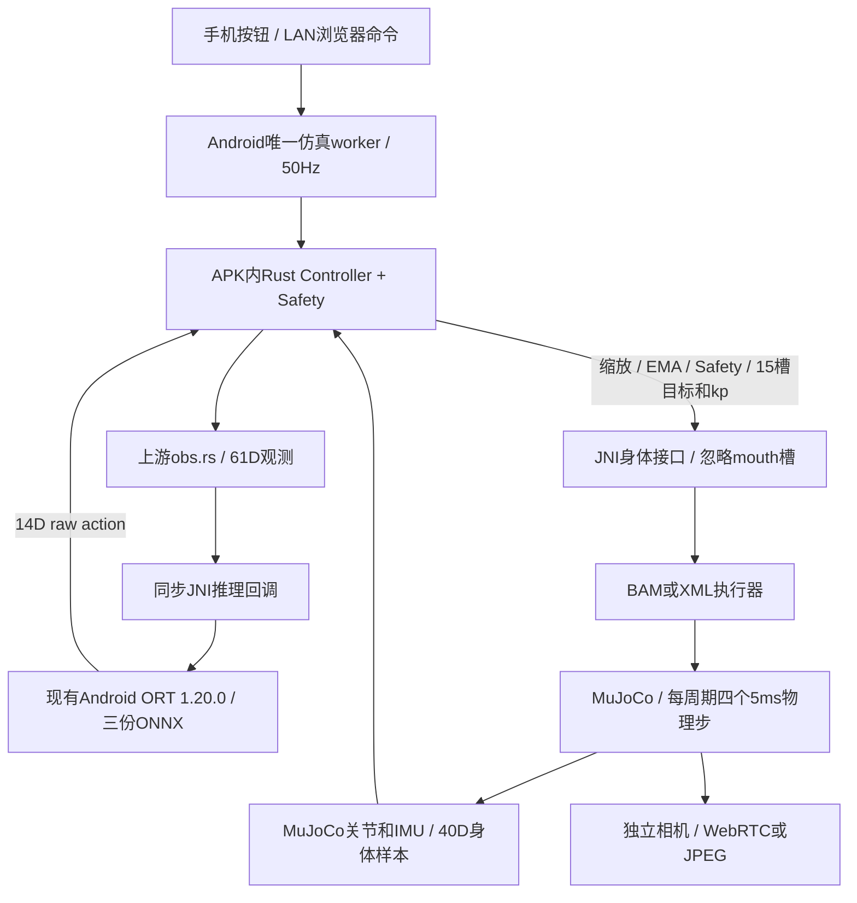
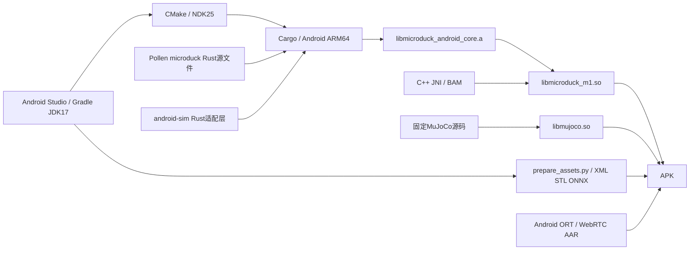

# M10：APK 内嵌 Rust 控制核心

版本 `0.10.0-m10` / versionCode=18，手机标题 `Microduck · Android M10`。本地站立、前进、翻滚及浏览器动作控制，默认走APK内的Rust核心。运行时不需要电脑、USB、Python或桌面robotd。用户继续在Android Studio编译、安装、运行；PDF已同步M10，见 [详细技术说明](docs/Android_Microduck_方案架构与编译复用说明.pdf)。

## 现在怎样使用

在Studio打开 `android-sim`，Sync、Build、Run，确认M10。直接点“策略站立”“前进 0.30m/s”“向前翻滚一次”。浏览器仍通过原LAN服务、4位访问码控制和观看机器人相机。BAM默认启用，可切回XML对照。

**本地内嵌模式不用开启“Rust身体服务”。** 那个按钮仍用于电脑robotd经USB接管，命令见 [BAM_SIMIO.md](BAM_SIMIO.md)。服务开启期间本地Rust策略停用、网页只监看；手机动作按钮会关闭该服务并接管。两种控制器不会同时写身体。

用户已确认M10实机验证通过，见 [user-M10-feedback.json](verification/user-M10-feedback.json)；没有另取性能/codec/细分动作验收日志。本机已经安装 `aarch64-linux-android` Rust标准库并验证原生编译。换电脑时，在已有Rust工具链的环境执行：

```bash
rustup target add aarch64-linux-android
```

本机验证工具链Rust/Cargo 1.98.1；Gradle JDK仍为JBR17.0.14，Java release11，NDK25.1.8937393、CMake3.30.3、Android API28+、arm64-v8a保持。Studio的CMake会从PATH或 `~/.cargo/bin/cargo` 找Cargo；首次Cargo依赖下载需要网络。编译失败时检查Rust目标和Cargo路径，无需改用桌面robotd才能本地行走。

## 运行架构



Rust库作为静态库链接进 `libmicroduck_m1.so`，随APK打包。没有在手机启动robotd子进程，也没有本机TCP绕行。ORT会话仍由 `PolicyRunner` 管理并校验模型SHA和烟测；Rust同步调用Java的 `rustInfer`，获取真实14D输出。原来Java/C++中的观测、动作缩放和滤波实现不再参与本地策略决策，保留的接口用于历史对照。

## 真正复用哪些上游代码

| 上游文件 | APK内作用 |
| --- | --- |
| `Pollen/microduck/robotd/src/control.rs` | 原版Controller：状态选择、技能窗口、raw action反馈、动作缩放、头/腿EMA、kp |
| `Pollen/microduck/duck-control/src/obs.rs` | 61D观测组装与mouth槽映射 |
| `model.rs` / `imu.rs` / `io.rs` | 关节顺序、HOME、传感器和RobotIo契约 |
| `safety.rs` | 非有限目标拒绝、±π执行器行程限制、跌倒状态报告 |
| `robotd-params` / `duck-ipc-proto` / `kinematics` | 使用原crate及配置/协议类型，由Cargo编译所需依赖 |

上述文件通过path模块或path依赖直接编译，两个Pollen仓库源码未修改。`build.rs`将原版control.rs原文放入Cargo构建目录，追加Android生命周期方法：`android_cancel_skill`清除活动技能并保留raw action/EMA目标；`android_start_roll`允许上一次100周期完成后立即再翻一次，同时忽略在途重复请求。

Android特有的Rust `policy.rs`是推理适配器，替代上游依赖桌面ORT动态库的加载器。只支持当前三份feedforward模型，明确拒绝未接入网络；不冒充完整原版policy.rs。固定来源、逐文件SHA见 [RUST_CORE.lock.json](RUST_CORE.lock.json)，Cargo依赖固定在 `rust/control-core/Cargo.lock`。构建脚本会校验引用的上游文件；上游变化时需重新核对、更新锁与验证，不能直接把旧报告当新构建证据。

## 构建复用关系



训练仓库仍只提供模型资源，Studio不训练、不运行Python BAM、不执行CAD导出。与M9相比，新增的是**Rust源码编译和静态链接依赖**，不只是读取Rust仓库里的ONNX。原版桌面robotd二进制不进入APK。

## 行为和边界

- 本地初次启用仍先复位HOME；没有新增桌面sitstand起身策略。已运行时调整速度保留姿态。
- 前进基准继续0.30m/s；0.15几乎不走的已知策略表现不因Rust内嵌自动改变。
- 站立scale1.0/kp160，步行scale0.9/kp200，翻滚scale1.0/kp200；默认EMA头0.5/腿0.7。只由Rust执行一次，JNI直接写目标，不重复过滤。
- 翻滚仍100个完成控制周期、2秒、不可通过重复点击延长；暂停不消耗周期。Rust决定实际网络，Java的RouladeWindow只负责界面计数/请求去重。
- Safety跌倒判定只报告，不中断翻滚；不宣称包含原版daemon完整跌倒恢复、命令EMA、温控、电池逻辑、硬件驱动、热加载和全部技能。
- 本地指令按现有UI规则保持；浏览器超时仍由Android RemoteLease处理。虽然复用Safety gate，本地调用的intent_age=0，不能把它当成另加了一层Rust通信死手保护。
- Rust句柄仅在创建线程有效；close后的句柄、跨线程调用、错误数组宽度、非有限传感器和无效推理输出均拒绝。JNI不持有跨周期的Java对象指针，回调异常传回仿真worker，由Activity暂停。
- Activity结束时销毁Rust状态和ORT会话；切换SimIo或重新启用时重置策略。BAM训练随机化/执行器延迟仍未移植。当前Safety是仿真策略边界，不代表可直接控制实物机器人。

## 关键代码

| file:line | 内容 |
| --- | --- |
| `rust/control-core/src/lib.rs:1` | 上游模块复用、身体适配器及线程所属句柄 |
| `rust/control-core/src/lib.rs:44` | 默认调参和2秒翻滚配置 |
| `rust/control-core/src/lib.rs:93` | 传感器→Controller→Safety→目标 |
| `rust/control-core/src/policy.rs:18` | ONNX同步回调和输出检查 |
| `rust/control-core/build.rs:1` | 原版Controller及取消技能扩展 |
| `app/src/main/cpp/rust_control_jni.cpp:1` | JNI/C ABI及异常边界 |
| `app/src/main/java/com/microduck/sim/PolicyRunner.java:90` | Rust调用现有ORT会话 |
| `app/src/main/java/com/microduck/sim/PolicyRunner.java:97` | 生产本地控制周期 |
| `app/src/main/cpp/native_sim.cpp:288` | 紧凑身体传感器样本，无JSON序列化 |
| `scripts/build_rust_core.py:1` | 源文件校验及Android交叉编译 |

## 已验证和仍待验证

- [m10-checks.json](verification/m10-checks.json)：真实Android AAR/JDK17 release11编译、ARM64 JNI语法及原有HTTP、相机、网页和SimIo协议回归。
- [m10-android-rust-checks.json](verification/m10-android-rust-checks.json)：实际CMake/NDK链接成功；ARM64 `.so`含Rust及JNI入口、LOAD段16KB对齐，动态依赖仅MuJoCo和Android系统库。该结果不改变旧ORT AAR的对齐限制，也不代表APK整体16KB验收。
- [m10-embedded-rust-checks.json](verification/m10-embedded-rust-checks.json)：生产PolicyRunner、真实Java ORT 1.20.0、JNI、Rust核心、MuJoCo/BAM主机闭环。站立5秒稳定，0.30指令3秒前进约0.254m，翻滚约359°后站立恢复；XML回退及JNI回调异常通过。Rust测试覆盖61D反馈、缩放/滤波/kp、100周期窗口、取消/复位、线程归属、异常和Safety限制。

这些自动化结果来自主机。用户另已确认M10实机验证通过；这是功能确认，不扩展为实测速度、性能或长期稳定性结论。性能/温升/30秒专项继续延期。未执行Gradle/APK构建、安装或设备操作，PDF已更新到M10。

主机闭环检查命令（本机JAR路径按实际填写；桌面ORT JAR只用于验证，不加入APK）：

```bash
python3 scripts/check_embedded_rust.py \
  --java-home /Users/navinfo/Library/Java/JavaVirtualMachines/jbr-17.0.14/Contents/Home \
  --mujoco-dir ../Pollen/microduck_rl/.venv/lib/python3.12/site-packages/mujoco \
  --ort-jar /private/tmp/microduck-onnxruntime-1.20.0.jar \
  --host-json-jar <本机org.json.jar>
```

桌面ORT JAR来自Maven Central的 `com.microsoft.onnxruntime:onnxruntime:1.20.0`，下载摘要记录在报告中。Rust集成测试可单独运行 `cargo test --manifest-path rust/control-core/Cargo.toml --locked --test core`。
