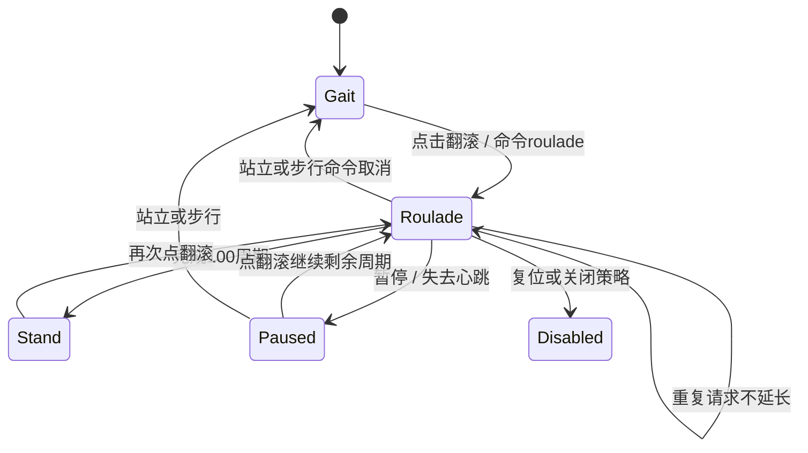

# M7.1：向前翻滚一次

手机与网页新增“向前翻滚一次”。使用本地已有 `Pollen/microduck/policies/roulade.onnx`，不重新训练或修改上游。固定SHA-256为 `3d60da08fc13f29c1b57f41977aa898132c0d60042100149d8e775affcbca32b`；ONNX为float32 `obs[1,61] → actions[1,14]`，关节顺序与站立/步行相同。三策略摘要与两组推理对照在 `app/src/main/assets/policies/manifest.json:1`、`smoke.json:1`；启动会验证所有策略。

## 使用

在Studio运行M7.1（versionCode=14 / `0.7.1-m71`），先点“策略站立”等待稳定，再点“向前翻滚一次”；手机和控制浏览器都可触发。已启用策略时保留当前姿态，首次启用时从HOME开始。原动作过滤默认开启，保持此设置使用当前基线。网页升级后需刷新、重新连接；相机保持前台及3D开启，见 [VIDEO.md](VIDEO.md)。

动作窗口是100个成功完成的20ms控制周期，即2秒仿真时间。第101周期选择站立策略，继续运行并尝试恢复平衡，不瞬移复位、不自动开始下一次翻滚。窗口到期表示推理时间结束，不表示已检测到360°翻滚成功。

重复点翻滚不会延长或重启在途动作；结束后可再点一次。暂停冻结剩余周期，再点翻滚继续；切到站立/步行取消窗口，复位关闭策略并清空历史。策略关闭后重新启动从HOME开始。远程心跳、3秒断连暂停和本地接管保留。

接口为 `POST /api/command`，JSON `{"op":"roulade"}`，认证方式见 [NETWORK.md](NETWORK.md)。报告新增 `roulade_active`、`roulade_remaining_ticks`、`roulade_completed`、`roulade_duration_s`；completed只统计窗口执行完毕，不能当成功次数。它在策略reset时清零。

## 推理与执行



翻滚期间13D command全部置零；上一周期raw action作为61D观测里的动作反馈，保持原布局。翻滚目标 `HOME + 1.0 × raw_action`，XML位置伺服增益倍率1.0；默认过滤头部0.5、腿部0.7。切回站立目标scale=1.0、gain=0.8；原步行scale=0.9、gain=1.0。切换不清空原生上一目标，因此过滤连续。

M7沿用了Rust原型的1秒窗口 `Pollen/microduck/robotd-params/src/lib.rs:1330`，用户实测未完成整圈。M7.1改为训练仓库CPU推理入口的2秒 `Pollen/microduck_rl/scripts/infer_policy.py:1184`，并用实际ONNX与Android XML伺服作交接时刻对照；没有修改过滤、动作倍率、模型或策略权重。全幅动作与gain仍依据原型说明 `Pollen/microduck/deploy/robotd.toml:184`。这不宣称复刻最新桌面技能manifest全部行为；Android本轮只提供单次动作。

## 检查与边界

`verification/m71-checks.json:1`覆盖Java/ARM64 JNI、窗口100周期且重复请求不延长、HTTP/网页翻滚命令、native倍率与原物理推进对照。策略二进制仍按工程惯例不上传Git；新机器需要三份策略，见 [DEPENDENCIES.md](DEPENDENCIES.md)。

用户已确认M7摄像头正常、前滚翻不完整，来源 `verification/user-M7-camera-roll-feedback.json:1`。复测时ADB没有设备，未抓到这次真机动作状态。旧1秒预演保留 `verification/host-roulade-rehearsal.json:1`。

`scripts/roulade_rehearsal.py:1`比较1/1.5/2/2.5/3/4/5秒交接，每种覆盖HOME/站立1秒及过滤开/关，输出 `verification/host-roulade-duration-sweep.json:1`。默认2秒另存 `verification/host-roulade-m71.json:1`，包含每0.2秒的姿态轨迹及头部接触。实际control ticks与总仿真时间有断言，避免标签和执行时长不一致。

| 交接时间与初始姿态（默认过滤） | 局部pitch积分 | 交接时身体倾角 |
| --- | --- | --- |
| 1秒，HOME | 254° | 103° |
| 1秒，站稳 | 236° | 121° |
| 2秒，HOME | 356° | 2.76° |
| 2秒，站稳 | 360° | 1.80° |

2秒四组pitch积分约356–365°，解包后的姿态投影约357–365°，交接时倾角1.8–5.0°；再接站立3秒倾角约0.24–0.26°，均数值有限。这支持“1秒过早交接”的原因与2秒候选修复。角速度积分、姿态投影和头部接触仍不等于严格的头顶支撑滚翻成功检测；任意步行/跌倒起始姿态及M7.1真机效果待确认。

在外层工作区手动重放（需要RL的Python环境）：

```bash
Pollen/microduck_rl/.venv/bin/python android-sim/scripts/roulade_rehearsal.py
Pollen/microduck_rl/.venv/bin/python android-sim/scripts/roulade_rehearsal.py --sweep
Pollen/microduck_rl/.venv/bin/python android-sim/verification/camera_visibility_check.py
```

性能、温升与前后台验收按用户要求延期；本轮代理未运行Gradle、安装或启动APK。

| file:line（相对android-sim） | 作用 |
| --- | --- |
| `app/src/main/java/com/microduck/sim/MainActivity.java:115` | 手机按钮 |
| `app/src/main/java/com/microduck/sim/MainActivity.java:260` | 当前状态触发翻滚 |
| `app/src/main/java/com/microduck/sim/MainActivity.java:270` | 物理成功后推进时间窗口 |
| `app/src/main/java/com/microduck/sim/MainActivity.java:486` | 远程命令 |
| `app/src/main/java/com/microduck/sim/PolicyRunner.java:81` | 启动窗口、零command |
| `app/src/main/java/com/microduck/sim/PolicyRunner.java:86` | ONNX选择、raw反馈、JNI动作 |
| `app/src/main/java/com/microduck/sim/RouladeWindow.java:4` | 有界窗口与计数 |
| `app/src/main/cpp/native_sim.cpp:91` | scale/gain/过滤 |
| `app/src/main/cpp/native_sim.cpp:259` | 翻滚JNI入口 |
| `app/src/main/java/com/microduck/sim/RemoteCommand.java:20` | 命令参数校验 |
| `app/src/main/assets/controller.html:28` | 网页按钮 |
| `scripts/prepare_assets.py:39` | 收集三份策略 |
