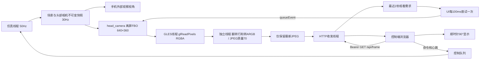

# M6：机器人头部摄像头

当前源码 `0.6-m6` / versionCode=12，手机标题 `Microduck · Android M6`。由用户在Android Studio编译、安装、运行。用户2026-10-04要求继续功能开发，性能、温升和前后台验收留到后面。

## 视频源与桌面端的关系

M6视频来自模型的 `head_camera`：在相机的世界位置、朝向和视场角下重新渲染场景。手机上保留可拖动的外部观察视角，改变该视角不会改变机器人相机。摄像头位置跟随头部关节和机身姿态；相机画面不加入观察窗口的轨迹/接触点标注。

旧M5–M5.4使用PixelCopy复制观察窗口。旧版视频显示及两次30秒预算测试已通过，但它们不是机器人相机的验收结果，历史证据保留在 `verification/device-M54-video-acceptance.json` 和 `verification/device-M54-video-off-acceptance.json`。

| 机制 | 桌面代码 file:line（相对外层工作区） | Android实现 |
| --- | --- | --- |
| 模型相机 | `android-sim/app/src/main/assets/model/robot_groundcontact.xml:257` | 同一MJCF的head_camera |
| 相机注册 | `Pollen/microduck_rl/src/mjlab_microduck/sim/body_server.py:568` | 快照按名字解析head_camera |
| 原始640×360帧 | `Pollen/microduck_rl/src/mjlab_microduck/sim/camera.py:28` | 相同尺寸；Android目标10FPS，桌面默认15FPS |
| 相机局部X轴转180° | `Pollen/microduck_rl/src/mjlab_microduck/sim/camera.py:94` | 在CPU快照中右乘diag(1,-1,-1)，不修改模型 |
| 相机渲染 | `Pollen/microduck_rl/src/mjlab_microduck/sim/camera.py:113` | GLES独立FBO相机渲染 |
| 安装方向90° | `Pollen/microduck/mediad/src/main.rs:229`、`Pollen/microduck/mediad/webclient/index.html:161` | 原始帧保留，网页顺时针旋转90° |

桌面相机先修正MJCF里朝后的视线，保留真实摄像头的侧向安装约定，由消费者旋转。Android沿用同一约定。模型默认垂直FOV为45°；裁剪距离沿用MuJoCo的 `vis.map.znear/zfar × stat.extent`，当前场景约0.00354–17.712m。视场和姿态有桌面对照，材质/光照/天空及地面仍使用Android简化绘制，没有完全复制桌面MuJoCo画面效果。

当前场景主要是机器人和地面，相机看到地面、视野边缘的机身或空背景可能是当前头部姿态的正常结果。它是仿真头部相机，不调用Android设备的实体摄像头。

## 在Studio运行和使用

1. 重新编译运行，确认标题M6；保持仿真应用前台及“显示3D”开启。
2. 开启局域网控制，控制设备连接同一Wi-Fi，重新打开应用显示的地址，刷新网页并连接。每次服务开启都生成新访问码。
3. 勾选“开启机器人摄像头”。首次短暂等待后应出现头部相机视野。原始JPEG为640×360，网页旋转后以竖向画面展示。
4. 可点策略站立或前进观察机器人视野变化。拖动仿真手机的外部观察视角，网页相机视角应保持由机器人头部决定。暂停时还能持续收到静止的相机画面。

本轮只需使用新功能，不要求重新跑30秒性能或前后台测试。Android真实FBO、画面方向及网页显示尚待用户Studio运行确认，主机检查不能替代它们。

当前FBO复用手机GLES上下文与已上传网格，因此需保持手机“显示3D”及Surface可用；关闭3D时返回503等待画面。此实现已分开两套视角，尚未分离GPU上下文以支持隐藏观察窗口时独立运行相机。

## 线程与数据流

只有仿真线程读取MuJoCo状态；GLES收到CPU数组，不持有原生模型句柄。快照v2在原几何/接触点数据后追加16个float：相机存在标记、FOV、世界位置3D、修正后的世界旋转3×3、近/远裁剪距离。相机视图矩阵使用相机到世界变换的逆，MuJoCo的局部−Z为视线、+Y为上方。

GLES线程复用网格，另建颜色纹理与深度缓冲，用相机投影绘制场景并同步读回RGBA。最终恢复窗口framebuffer/viewport；该pass不改变观察窗口的视角设置。编码线程把GLES从下向上的行序转换为Android从上向下的ARGB后编码；网页负责安装方向旋转。

一个会话最多一个排队渲染/读回/编码任务，没有观看请求不发起任务、最后请求2秒后停止新任务。缓存仍是一个不可变JPEG，单帧上限512KiB、2秒以上旧帧不返回；编码慢则跳过后续采集机会。关闭会话清空缓存，迟到回调不能发布到新会话。已有控制/心跳路径和3秒租期机制保留。

`GET /api/frame`沿用Bearer访问码，返回JPEG与 `X-Frame-Sequence` / `X-Frame-Age-Ms`；没有可用画面503、访问码错误401。视频请求独立于控制命令。HTTP仍为两个收发线程、四个等待连接、每次响应一帧后关闭；网络和控制细节见 [NETWORK.md](NETWORK.md)。当前传输仍是JPEG HTTP，没有移植桌面WebRTC/H.264/UYVY协议。

## 报告字段

| 字段 | M6含义 |
| --- | --- |
| `video_source` | head_camera |
| `video_backend` | head_camera GLES framebuffer / JPEG latest-frame HTTP |
| `video_mount_rotate` | 消费者顺时针转90°，JPEG仍保持原始640×360 |
| `head_camera_available` / `head_camera_fovy_degrees` | 最新场景快照包含相机 / 模型垂直FOV |
| `video_enabled` / `video_demand_active` / `video_copy_pending` | 会话开启 / 最近2秒观看需求 / 一个相机任务正在处理 |
| `video_copy_ms` | 保留字段名，改为采集请求至GLES读回完成的耗时，含GL排队及相机渲染，不是PixelCopy |
| `video_encode_ms` | 最近一次ARGB转换、Bitmap填充及JPEG编码耗时，不含编码线程队列等待 |
| `video_width` / `video_height` | 原始相机JPEG尺寸，不是旋转后的显示尺寸 |
| `video_frame_age_ms` | 状态捕获时距采集请求的帧龄，不是端到端显示延迟或物理状态年龄 |
| `video_frames_published` / `video_frames_served` | 会话累计发布 / 提供给HTTP，后者不证明浏览器已显示 |
| `video_capture_failures` / `video_error` | 相机渲染、读回或编码失败统计 |
| `test_video_frames_published` / `test_video_frames_served` | 保留的30秒测试增量，M6本轮未做真机性能验收 |

## 检查结果与代码入口

[verification/m6-checks.json](verification/m6-checks.json)包含JDK11/Android34/ORT Java编译、Android ARM64 JNI语法、原物理观测/动作与网格快照、相机矩阵和像素转换、缓存/HTTP/模拟网页检查。三组头部/机身姿态与桌面“修改cam_quat后再forward及mjv_updateScene”的独立对照，最大误差约2.6e-8；没有修改模型相机或训练文件。原500周期物理基准状态仍逐项一致。

主机没有执行Android GLES FBO、JPEG真实图像解码或真实浏览器CSS旋转；这些仍需手机运行确认。性能、温升、前后台、端到端延迟按用户要求延期；原M5.4性能不能外推到当前相机。

| file:line（相对android-sim） | 作用 |
| --- | --- |
| `app/src/main/cpp/visual_snapshot.h:59` | 场景与头部相机快照 |
| `app/src/main/java/com/microduck/sim/SceneFrame.java:6` | v2数据校验、相机尾部解析 |
| `app/src/main/java/com/microduck/sim/HeadCamera.java:6` | 相机姿态/FOV/裁剪校验及视图矩阵 |
| `app/src/main/java/com/microduck/sim/RobotSurfaceView.java:44` | 将相机任务提交到GLES线程 |
| `app/src/main/java/com/microduck/sim/RobotSurfaceView.java:217` | 相机投影、独立绘制、读回及窗口状态恢复 |
| `app/src/main/java/com/microduck/sim/RobotSurfaceView.java:242` | 创建/检查相机FBO |
| `app/src/main/java/com/microduck/sim/VideoCapture.java:29` | 按需发起相机任务及JPEG编码 |
| `app/src/main/java/com/microduck/sim/CameraPixels.java:6` | RGBA到ARGB和行序翻转 |
| `app/src/main/java/com/microduck/sim/VideoCapture.java:57` | 相机报告字段 |
| `app/src/main/assets/controller.html:14` | 90°旋转布局 |
| `verification/visual-bridge-check.cpp:1` | 桌面相机及原几何对照 |
| `verification/HeadCameraCheck.java:1` | 视图矩阵、无效参数及像素转换检查 |
