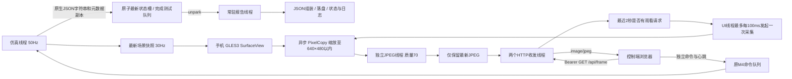

# M5.3：浏览器实时画面与报告队列优化

当前源码 `0.5.3-m53` / versionCode=10，手机标题 `Microduck · Android M5.3`。保留连续JPEG画面，调整周期性报告提交路径。用户通过Android Studio构建/安装/运行；源码检查不打包或安装APK。

M5.2最新复测：30秒发布297帧/9.90FPS、HTTP提供269帧、错误0、手机约30FPS。完整工作线程p99=13.130ms/max=21.270ms、超20ms周期1；配对sample1365的控制+快照8.404ms、原生状态0.152ms、四项元数据捕获合计0.144ms，队列提交区间12.545ms。原始报告 [device-M52-video-on-realtime-test.json](verification/device-M52-video-on-realtime-test.json)，对比 [device-M52-video-acceptance.json](verification/device-M52-video-acceptance.json)。区间包含对象构造、提交及唤醒，仍不足以证明锁等待或GC/调度的具体原因。

M5.3用常驻报告线程替换按需Executor drain：普通状态通过AtomicReference交换，只保留最新待处理项；完成测试通过ConcurrentLinkedQueue保留。提交不再与消费者共享monitor。原子准入计数保证close拒绝新任务，同时等待已准入生产者发布后再退出；close不等待报告I/O，已接受任务仍落盘。已捕获对象直接实现Runnable，写入回调只初始化一次。新增准入、发布、唤醒的墙钟耗时和提交区间线程CPU耗时；真机效果待测。

M5.1复测：30秒发布298帧/9.93FPS、HTTP提供271帧、错误0；报告捕获平均1.312ms，但仍有1个22.613ms周期，配对记录显示控制+快照4.533ms、原生状态0.162ms、元数据捕获/提交17.879ms。原始报告 [device-M51-video-on-realtime-test.json](verification/device-M51-video-on-realtime-test.json)，对比 [device-M51-video-acceptance.json](verification/device-M51-video-acceptance.json)。该区间可能包含分配、调度及锁等待，记录不直接证明具体原因。

M5.2将应用、渲染、视频、策略元数据的JSONObject/JSONArray构造移入报告线程。仿真线程先复制标量和不可变VideoFrames.Status，报告回调只读这些副本；原生state仍由仿真线程读取。JPEG副本在编码线程、状态锁之外分配；单个采集任务仍串行，关闭期间产生的副本不再发布。五项捕获/队列计时已在真机定位上述区间，完整预算尚未通过。

M5已在真机采集并由用户完成浏览器画面/按钮测试：576×480、30秒发布298帧/9.93FPS、提供给HTTP268帧，采集错误0、手机30FPS。完整工作线程仍有3周期超过20ms、max=22.422ms，报告捕获max=16.246ms；两个最大值没有配对，不能确定同周期或直接归因。原始证据 [device-M5-video-on-realtime-test.json](verification/device-M5-video-on-realtime-test.json)，对比 [device-M5-video-acceptance.json](verification/device-M5-video-acceptance.json)。

代码检查发现原周期性报告在控制线程解析原生JSON、转字符串后再解析；M5.1保留原生JSON字符串，单独捕获独占元数据，在报告线程解析/合并。原生state调用仍在仿真线程，报告线程不访问模型、策略或工作线程可变字段。完成测试显式进入保留队列。M5.1实际复测见上文；本次队列改动的性能效果须复测。

## 使用及真机验收

1. Studio重新编译运行，确认标题M5.3，保持“显示3D”开启，手机应用在前台。
2. 点“开启局域网控制”，控制设备使用同一Wi-Fi，重新打开应用显示的地址并连接。旧M4页面需要刷新；访问码依然每次开启服务时更新。
3. 浏览器勾选“开启实时画面”。首次可能短暂显示等待，随后显示仿真手机的3D视图及尺寸、接收FPS、采集帧龄。目标10FPS，最大640×480，JPEG质量70。它显示机器人、地面、轨迹和接触点，跟随仿真手机的当前相机视角。
4. 在网页点站立、前进、暂停，确认控制及时、画面方向正确且不黑屏。暂停时机器人不动，画面仍可更新相机视角；开启画面本身不会启动仿真。
5. 保持网页画面开启，在仿真手机点“实时测试30s”，等自动暂停后告诉代理读取报告。测试期间不要操作相机/速度/复位。核对M5.3、LAN开启、`test_video_frames_published`和`test_video_frames_served`均大于0、控制周期与完整工作线程预算。没有视频帧的测试不能算视频开启测试。
6. 取消画面开关，确认停止请求；保留网页连接，再做一次30秒对照。先保存开启画面的归档，第二次会覆盖同一文件。
7. 验证浏览器切后台后暂停、回前台后画面恢复但仿真不自行运行；仿真手机离开应用后关闭服务，回前台需手动开启并使用新访问码。

```bash
# 每次测试后导出，避免下一次覆盖；设备序列号可按实际修改。
adb -s 10AC710LRV001H8 shell run-as com.microduck.sim cat files/last-realtime-test.json > /tmp/microduck-m5-video-on.json
# 网页关闭画面、再次测试后执行：
adb -s 10AC710LRV001H8 shell run-as com.microduck.sim cat files/last-realtime-test.json > /tmp/microduck-m5-video-off.json
```

## 架构与边界



手机采集的是现有SurfaceView，不二次绘制机器人，不访问原生模型或ONNX session。PixelCopy复制最近排入Surface的缓冲区并缩放到目标Bitmap，回调在指定Handler执行，依据 [Android PixelCopy官方文档](https://developer.android.com/reference/android/view/PixelCopy)。JPEG编码使用 [Bitmap.compress](https://developer.android.com/reference/android/graphics/Bitmap#compress(android.graphics.Bitmap.CompressFormat,%20int,%20java.io.OutputStream))，在独立线程执行；UI只调度采集，仿真工作线程只捕获少量视频统计。

每个LAN会话拥有独立采集器和缓存；没有观看请求不采集，最后请求2秒后不再发起新采集。最多一个PixelCopy/编码任务，慢编码跳过后续采集机会，最新帧覆盖旧帧；单帧上限512KiB，超限或2秒以上旧帧不返回。关闭服务清空缓存、停止调度及编码线程，旧回调不会发布到新会话。关闭3D后返回503等待画面。视频不会延长远程运行租期，3秒心跳暂停逻辑仍由控制链路负责。

浏览器默认关闭画面，开启后最多10次/秒拉取最新JPEG、同一页面最多一个画面请求；视频请求独立于串行命令/心跳。单次画面请求1.5秒超时，503等错误稍后重试；切后台/关闭画面取消请求，旧会话迟到响应不能恢复画面，使用后的Blob URL会释放。HTTP没有持续流连接：每次请求返回一帧后关闭，沿用2个收发线程/4个等待连接，服务器从开始处理请求起3秒后关闭仍未完成的socket，包含写出阶段；排队等待不计入这3秒。

`GET /api/frame`需要相同Bearer访问码，成功返回`image/jpeg`及`X-Frame-Sequence`、`X-Frame-Age-Ms`，未采到可用画面返回503、访问码错误401。访问码不放在图片URL中，也不写入状态/日志/验证文件。此版为单个控制页面在局域网观看设计；JPEG独立帧带宽高于视频编解码，尚无音频、WebRTC/H.264或桌面webrtcsink协议。

## 报告与解释

| 字段 | 含义 |
| --- | --- |
| `video_enabled` / `video_demand_active` | 采集会话仍开启 / 最近2秒有观看请求；前者不表示正在编码 |
| `video_frames_published` / `video_frames_served` | 本次会话累计编码发布 / 提供给HTTP发送器的帧数；后者不证明浏览器已收到 |
| `video_copy_ms` / `video_encode_ms` | 最近一次异步复制回调耗时 / JPEG编码耗时，不含网络传输 |
| `video_width` / `video_height` / `video_jpeg_bytes` | 最新帧的尺寸与大小 |
| `video_frame_age_ms` / `video_error` | 最近一次状态捕获时帧龄 / 最近采集错误；暂停时缓存状态不持续刷新 |
| `test_video_frames_published` / `test_video_capture_fps` | 本次30秒测试新增的发布帧数及平均采集FPS |
| `test_video_frames_served` | 本次30秒测试提供给HTTP发送器的帧数 |
| `worker_tick_p99_ms` / `worker_tick_max_ms` | 完整控制线程周期耗时；CPU/GPU/内存争用仍可能影响它 |
| `native_state_capture_*_ms` / `report_metadata_submit_*_ms` | M5.1新增分项的p95/p99/max；无报告周期记0，因此分位数覆盖全部控制周期 |
| `worker_over_budget_samples` | 最多16个超20ms周期，配对记录sample_index、worker_tick、control_with_visual、native_state_capture、report_metadata_submit |
| `worker_over_budget_samples_truncated` | 超预算周期超过16时为true，计数和整体最大值仍覆盖全部周期 |
| `app_metadata_capture_*_ms` / `render_metadata_capture_*_ms` | M5.2应用标量捕获 / 渲染标量捕获的p95/p99/max |
| `video_metadata_capture_*_ms` / `policy_metadata_capture_*_ms` / `report_queue_submit_*_ms` | 视频不可变状态捕获 / 策略标量捕获 / 报告队列提交；同样无报告周期记0，配对样本包含这5项 |
| `report_admission_*_ms` / `report_mailbox_*_ms` / `report_wakeup_*_ms` | M5.3准入CAS / 原子发布和准入计数递减 / unpark及计时开销；均为墙钟耗时，包含被抢占的时间 |
| `report_submit_cpu_*_ms` | 由Debug.threadCpuTimeNanos记录的当前线程CPU差值，区间覆盖报告对象构造及提交；与上述队列墙钟区间边界略有差异，不能直接相减作为精确等待时间 |

以上提交分段也进入超预算配对样本，无报告周期仍记0。若提交墙钟尖峰而线程CPU很低，说明该线程在区间内大部分时间没有运行，但不能据此区分抢占、GC暂停或内核等待；若CPU也高，再针对计算路径调查。它们不是整周期线程CPU测量。

网页“接收FPS”统计本次开启以来成功解码的新序列；“采集帧龄”是服务器响应时距采集发起的时间，不是端到端显示延迟。手机30FPS渲染、10FPS采集目标和浏览器实际接收FPS是不同指标。

M4无视频基线：工作线程p99=16.618ms/max=19.129ms、30秒超20ms周期0；见 [device-M4-realtime-acceptance.json](verification/device-M4-realtime-acceptance.json)。不同次运行受频率/温度影响。M5/M5.1/M5.2分别有3/1/1个工作线程周期超预算；M5.3须重新测量，短实时测试不能替代长期温升和网络中断验证。

## 检查与代码入口

[verification/m53-checks.json](verification/m53-checks.json)包含Java对Android34/ORT的JDK11编译、Android ARM64 JNI语法、原物理观测/动作及渲染桥、视频缓存/会话、HTTP图片与心跳并发、网页模拟DOM/网络检查；报告测试验证阻塞I/O不阻塞提交/关闭、状态合并、完成测试保留、错误恢复、空闲唤醒、并发关闭保留已接收任务、直接提交报告对象。延后字段检查验证JSON组装发生在报告线程、捕获后命令改变不影响报告速度及非法JSON拒绝。HTTP夹具JPEG不解码图像，网页夹具不是真实浏览器。M5至M5.2实际采集已完成，但完整预算尚未通过；M5.3效果、长期温升及生命周期待测。

| file:line | 作用 |
| --- | --- |
| `app/src/main/java/com/microduck/sim/VideoCapture.java:12` | UI调度及独立编码线程 |
| `app/src/main/java/com/microduck/sim/VideoCapture.java:28` | 按需复制与复用Bitmap |
| `app/src/main/java/com/microduck/sim/VideoFrames.java:7` | 缓存、观看需求、单任务及时限 |
| `app/src/main/java/com/microduck/sim/LanControlServer.java:76` | 包含写出的socket截止时间 |
| `app/src/main/java/com/microduck/sim/LanControlServer.java:111` | 已授权的最新帧响应 |
| `app/src/main/java/com/microduck/sim/MainActivity.java:273` | 测试开始计数 |
| `app/src/main/java/com/microduck/sim/MainActivity.java:285` | 30秒视频/控制统计及配对记录 |
| `app/src/main/java/com/microduck/sim/MainActivity.java:348` | 标量捕获、报告回调与分段计时 |
| `app/src/main/java/com/microduck/sim/CapturedReport.java:7` | 报告线程解析原生JSON并合并 |
| `app/src/main/java/com/microduck/sim/ReportDispatcher.java:25` | 原子准入、发布、唤醒及关闭后任务保留 |
| `app/src/main/java/com/microduck/sim/RobotSurfaceView.java:40` | 渲染元数据副本 |
| `app/src/main/java/com/microduck/sim/PolicyRunner.java:85` | 策略/速度元数据副本 |
| `app/src/main/java/com/microduck/sim/VideoCapture.java:54` | 不可变视频状态副本 |
| `app/src/main/java/com/microduck/sim/VideoFrames.java:54` | JPEG副本分配移出状态锁 |
| `app/src/main/java/com/microduck/sim/MainActivity.java:436` | LAN会话创建采集器 |
| `app/src/main/java/com/microduck/sim/MainActivity.java:488` | 服务及采集关闭 |
| `app/src/main/assets/controller.html:55` | 独立画面轮询、解码及Blob释放 |
| `verification/VideoFramesCheck.java:1` | 缓存、旧帧、超限和关闭测试 |
| `verification/controller-check.js:1` | 模拟网页异步/生命周期测试 |
