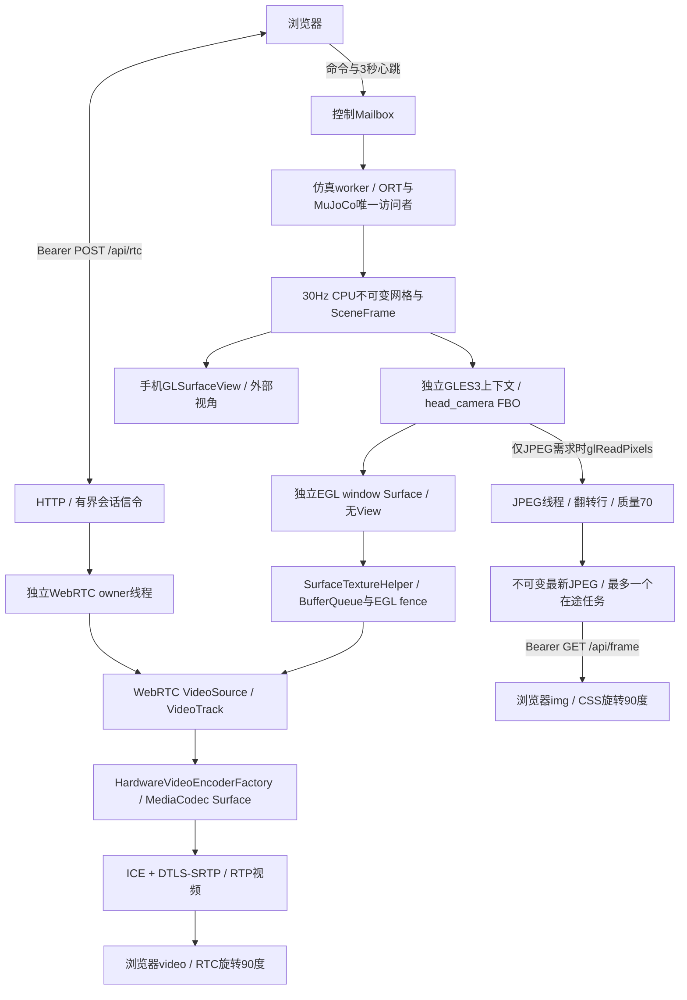

# M10：独立机器人相机与硬件编码 WebRTC

当前源码 `0.10.0-m10` / versionCode=18，手机标题 `Microduck · Android M10`。由用户在Android Studio Sync、编译、安装和运行。两项优先工作均已实现：独立相机 EGL/Surface 与 WebRTC 视频轨道/硬件编码。用户已反馈M8“实机验证正常”，记录见 [user-M8-video-feedback.json](verification/user-M8-video-feedback.json)。M8.1仅将局域网访问码改为4位数字；实际codec/硬件编码器细节未另取设备报告，性能/温升长测仍延期。

M9增加BAM与Rust身体服务，见 [BAM_SIMIO.md](BAM_SIMIO.md)。视频链路保持；身体服务期间网页只监看，动作控制由Rust接管。M8功能已由用户确认，M9仍待Studio运行。

M10本地动作已由APK内嵌Rust核心执行，不需要电脑。构建与行为边界见 [RUST_CORE.md](RUST_CORE.md)。外部SimIo模式继续保留。

## Studio运行与功能验收

1. Sync、Build、Run；确认标题M10。首次Sync下载Stream WebRTC 1.3.9及传递依赖，当前Studio使用JBR 17.0.14作为Gradle JDK；AGP7.2.2/Gradle7.5保持，Java源码/输出兼容级别为11。
2. 手机保持应用前台，开启局域网控制；控制设备用同一Wi-Fi/热点，刷新控制网页，使用本次4位数字访问码连接。
3. 勾选“开启机器人摄像头”，默认WebRTC。画面下方应显示 `video/H264` 或实际协商codec、解码累计帧和接收FPS。设置是优先H.264，不能把“设置了优先”当成已经协商成功。
4. 手机关闭“显示3D”，点站立/前进：浏览器相机应继续随机器人头部运动；开启3D并拖动外部观察视角，相机应仍由头部姿态决定。
5. 切换JPEG兼容模式作对照，再切回WebRTC；暂停时仍可收到静止场景。核对两种传输的朝向一致，没有二次90°旋转、镜像、灰屏或拉伸。
6. 关闭网页相机再开启，检查能重新连接及操作按钮正常。无需跑30秒性能测试。

目前仅支持一个WebRTC观看者；新观看会话替换旧会话。JPEG是手动可选兼容模式，WebRTC失败会显示原因和切换提示。没有音频/手机实体摄像头权限；视频源是模型 `head_camera`。

同网段还需允许设备互通及WebRTC媒体连接。没有STUN/TURN服务器，不提供公网穿透。HTTP访问码用于信令认证；媒体由WebRTC的ICE、DTLS-SRTP承载。不能用TCP `adb forward` 的HTTP连通证明UDP媒体可达。

## 技术架构



两个 `SceneRenderer` 实例各自上传GPU网格和持有GL名字，复用绘制实现。共享的是只读CPU数组；相机上下文不与外部预览共享GL对象。相机与WebRTC编码器的纹理上下文按SDK方式共享。关闭手机3D不销毁相机，也不停止其快照更新。

`VideoCapture` 在camera HandlerThread创建GLES3 EGL上下文，先用1×1 pbuffer初始化，再换到 `SurfaceTextureHelper` 的640×360 window Surface。`renderHeadCamera` 在FBO按模型世界姿态/FOV/裁剪绘制，启用GL_BACK/CCW以免镜头内部背面遮挡。`presentHeadCamera`把FBO颜色blit到独立Surface并按单调时钟swap。WebRTC纹理路径不执行应用层RGBA读回或JPEG编码。硬件缺少Surface格式时，SDK可能进行YUV转换；是否真正使用Surface编码还需设备日志核对。

`SurfaceTextureHelper`管理OES纹理、SurfaceTexture变换和引用计数；在纹理被占用时跳过新采集，不缓存任意长度的视频帧队列。JPEG沿用640×360、目标10FPS、质量70、最近请求2秒需求及512KiB最新帧上限。WebRTC目标20FPS、码率上限1.5Mbps，网络自适应或背压可降低实际帧率。当前仍提供约30Hz场景快照，关闭3D但LAN开启时保留快照更新。

相机快照沿用桌面local X 180°修正。JPEG的RGBA行序转换与CSS顺时针90°保持；RTC使用 `VideoFrame` rotation=90并由浏览器处理，video元素不再加CSS旋转。相机位置、模型、ONNX、HOME、伺服、滤波和翻滚窗口均沿用M7.1基线。

## 信令、寿命与线程

`POST /api/rtc`使用已有 `Authorization: Bearer <访问码>`，JSON体上限32KiB。命令体仍512byte，头4096byte，读取2秒/处理起总期限3秒。视频信令不经控制命令的串行请求队列，也不访问MuJoCo/ORT。

| op | 请求字段 | 行为 |
| --- | --- | --- |
| open | id（32位十六进制随机会话标识）、sdp | 浏览器recvonly offer；原生异步设置remote、创建answer、设置local；HTTP立即确认受理 |
| poll | id、after（ICE游标） | 返回answer、增量ICE候选、next、state/error；每秒查询并续租8秒 |
| close | id | 只关闭匹配会话；也记录已取消id，防止迟到open恢复已关闭的观看者 |

浏览器先收集自己的ICE（最长等待4秒），再发送offer。Android通过poll提供trickle ICE；浏览器设置answer后应用候选。没有microphone/getUserMedia调用，不创建音轨或控制DataChannel。已有HTTP控制、3秒运行心跳、本地接管保持。

`RtcSession`按generation隔离旧answer/candidate/错误回调，最多128条ICE候选，answer上限24KiB，取消id最多64个/保留30秒。只允许一个待处理open。新会话替换peer，旧close不会关闭新peer；无poll超过8秒释放peer。浏览器关闭/切后台/切传输时关peer、撤销请求，尽力发close；网络丢失由租期兜底。

离开仿真Activity前台仍暂停并关闭LAN；回前台手动开新服务与新访问码。关闭camera采集后，WebRTC owner先释放peer/track/source/factory，再由camera owner停helper监听、释放GL/Surface，最后由helper引用计数释放尚持有的帧。native销毁不在仿真worker上等待。没有新增后台仿真/服务模式。

## 编译复用与依赖

新增固定Maven依赖 `io.getstream:stream-webrtc-android:1.3.9`，Gradle合并Java/native AAR；传递依赖Kotlin stdlib1.9.25、AndroidX annotation1.9.1（Android variant annotation-jvm）。实际AAR417个class均major55、minSdk21；arm64 JNI LOAD均16KB对齐。现有ORT1.20.0仍4KB对齐，不能宣称整个APK兼容16KB页设备。

AAR及传递JAR已用本机实际AGP7.2.2 builder内D8 3.2.74转换为临时DEX成功，无警告；只检查依赖，没有构建应用DEX/APK，也没有运行Gradle。锁定来源和摘要见 [VIDEO_DEPENDENCIES.lock.json](VIDEO_DEPENDENCIES.lock.json)，检查入口 `scripts/check_video_dependencies.py`，结果 [verification/m8-video-dependencies.json](verification/m8-video-dependencies.json)。许可/通知打包在 `app/src/main/assets/licenses/`；预编译native库的逐项第三方许可审计尚未完成。

两个Pollen仓库仍只提供模型/策略资源及控制约定；没有移植Rust mediad、GStreamer、SimIo或BAM，没有Cargo编译链。WebRTC由Android AAR及MediaCodec实现，并非复刻桌面mediad的协议。桌面原相机管线仍是Python Renderer→TCP UYVY→Rust/GStreamer/WebRTC。

## 报告与故障定位

| 字段 | 含义 |
| --- | --- |
| camera_context_independent / camera_surface / camera_gl_ready | 独立GL声明、Surface机制及初始化状态；声明不是实机验收结果 |
| camera_frames_rendered / camera_texture_backpressure_drops | camera渲染次数 / helper纹理占用造成的跳过次数 |
| camera_gl_error / camera_gl_renderer | 相机初始化或绘制错误 / GPU名称 |
| rtc_ready / rtc_active / rtc_connection / rtc_error | factory就绪 / 观看租期 / 原生peer状态 / 错误 |
| rtc_hardware_codecs / rtc_encoder_factory | 检测到的硬件codec / HardwareVideoEncoderFactory |
| rtc_codec / rtc_encoder_implementation | stats实际协商codec / 编码器名；协商或首帧前可能为空 |
| rtc_frames_submitted / rtc_frames_encoded / rtc_bytes_sent | 输入与编码计数 / 发送字节，不证明浏览器显示；后两项当前peer统计 |
| video_* | 保留JPEG缓存/读回/编码统计；不能当WebRTC FPS或端到端延迟 |

浏览器显示的是接收端inbound-rtp `framesDecoded`和codec；FPS由相邻统计差计算，不能当精确显示/端到端延迟。手机 `render_fps`是外部预览FPS，关闭3D后不应用它判断RTC是否出帧。

若WebRTC无图，先切JPEG：JPEG正常说明相机渲染基本可用，再查rtc_hardware_codecs、rtc_error、ICE state/设备互通及编码器日志。两路都无图查camera_gl_ready/error；图像方向不同查SurfaceTexture/rotation；有帧全灰查背面剔除/真实姿态，不改训练模型来掩盖渲染错误。

只读命令（用户Studio运行后）：

```bash
adb -s <SERIAL> shell run-as com.microduck.sim cat files/last-report.json
adb -s <SERIAL> logcat -d -s MicroduckM1:I HardwareVideoEncoder:D SurfaceTextureHelper:D "*:S"
```

M7灰屏修复及M7.1整圈翻滚已有用户确认。M8新增Java/实际AAR/ARM64 JNI、相机/物理对照、HTTP信令认证/大小、会话替换与乱序、浏览器异步控制检查见 [verification/m8-checks.json](verification/m8-checks.json)。这些不能证明Android实际EGL/编码器/媒体连接已运行成功。

- `app/src/main/java/com/microduck/sim/MainActivity.java:296`：worker生成快照并分别送预览/相机。
- `app/src/main/java/com/microduck/sim/SceneRenderer.java:148`：相机投影/剔除/FBO。
- `app/src/main/java/com/microduck/sim/SceneRenderer.java:183`：FBO到独立Surface。
- `app/src/main/java/com/microduck/sim/VideoCapture.java:34`：独立EGL和helper。
- `app/src/main/java/com/microduck/sim/VideoCapture.java:72`：按需采集/背压。
- `app/src/main/java/com/microduck/sim/RtcVideo.java:66`：信令入口。
- `app/src/main/java/com/microduck/sim/RtcVideo.java:93`：异步offer/answer与H.264优先。
- `app/src/main/java/com/microduck/sim/RtcVideo.java:191`：native寿命释放。
- `app/src/main/java/com/microduck/sim/RtcSession.java:9`：generation/租期/乱序隔离。
- `app/src/main/java/com/microduck/sim/LanControlServer.java:119`：HTTP信令路径。
