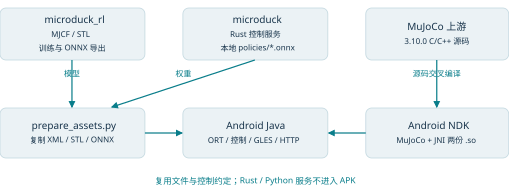
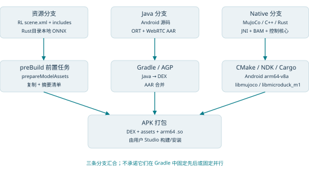
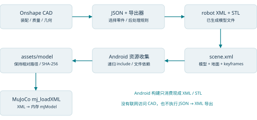
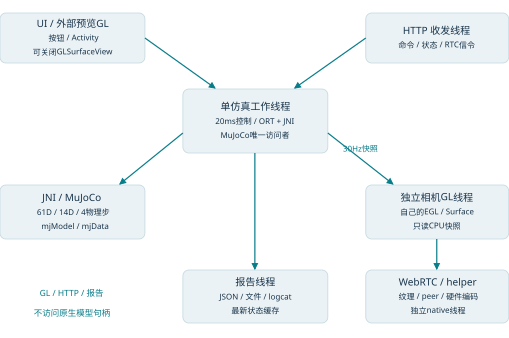
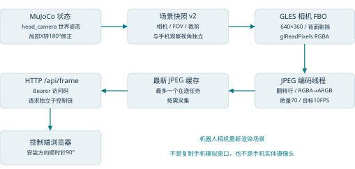
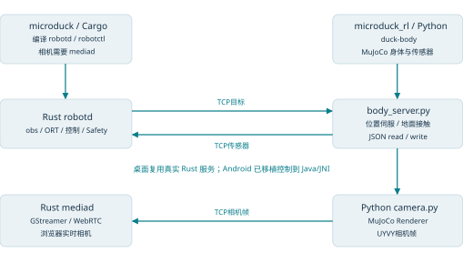

# Android Microduck：方案、技术架构与编译复用说明


## 01 方案定位与阅读结论

先确认运行的是什么，再理解如何编译和复用。

当前Android项目是一个独立原生应用：在手机内部用MuJoCo计算机器人运动，用ONNX Runtime执行站立、步行、前滚翻策略，用GLES3绘制机器人和头部相机，并用局域网HTTP接受另一台设备的浏览器控制。它支持一台Android仿真、另一台Android浏览器控制及看相机。

最重要的构建结论：Android使用两个Pollen仓库提供的模型与策略文件，但没有把Rust控制服务或Python训练框架交叉编译进APK。Android自己实现控制循环和渲染/网络；MuJoCo引擎另从上游C/C++源码编译为Android共享库，ORT Android直接使用Maven AAR。

| 问题 | 当前实现 |
| --- | --- |
| 是否需要先cargo build？ | Android构建不调用Cargo；microduck主要是本地ONNX的存放来源。 |
| 是否需要先uv sync或训练？ | 已有XML/STL和三份ONNX时，Android打包无需Python训练环境；资源脚本只用Python标准库。 |
| 是否需要重新导出CAD？ | Android读取已生成的MJCF/XML/STL，不执行Onshape导出。 |
| 为何还需要两仓库？ | prepare_assets.py按固定相对路径读取其中资源。目录依赖不等于二进制编译依赖。 |
| 手机里是否有MuJoCo Warp/PPO？ | 没有；手机运行CPU MuJoCo和CPU ONNX推理，PPO/Warp属于训练端。 |

直接证据：A/app/build.gradle:36；A/app/src/main/cpp/CMakeLists.txt:57；A/scripts/prepare_assets.py:6。当前版本来源：A/app/build.gradle:11。

> 本说明核对M8源码及已有验证记录。M8落地独立相机EGL/Surface与硬件WebRTC，主机检查通过；实际APK与新增视频功能尚待用户Studio编译运行。没有运行Gradle、打包APK、训练或自动操作手机按钮。


## 02 三个项目的职责与复用类型

文件复用、代码移植、设计借鉴分别列出。



| 项目 | 原本职责 | Android实际使用 |
| --- | --- | --- |
| microduck | Rust robotd/duck-control、CLI、媒体、板端部署、真实硬件接口 | 读取policies下的三份ONNX；移植观测布局、动作倍率、滤波和单次动作窗口约定。Rust源码不参与当前APK链接。 |
| microduck_rl | mjlab任务插件、PPO训练、BAM执行器、MJCF模型、导出与CPU仿真 | 复制scene.xml及递归XML/STL依赖；沿用HOME/关节布局/相机方向；其.venv只用于主机对照或训练。 |
| android-sim | Java控制/状态/网络、JNI物理桥、GLES和相机、Gradle/CMake | 实现手机运行闭环，并独立管理代码、构建配置及验证证据。 |
| MuJoCo上游 | 通用C/C++物理引擎 | 固定3.10.0源码，经NDK编译为libmujoco.so。 |

Rust工作区服务划分见 R/Cargo.toml:7；训练插件和命令入口见 T/pyproject.toml:40、T/pyproject.toml:55。

> 相同ONNX和相同几何不保证相同动作表现：执行器、延迟、滤波、初始化及策略交接都会改变闭环。本说明后面单独列出BAM与Android XML伺服差异。


## 03 Android构建链与产物总览

Gradle驱动资源、Java/AAR和NDK三条构建分支。



| 构建分支 | 输入 | 输出 |
| --- | --- | --- |
| 资源 | scene.xml/robot_groundcontact.xml/附加XML/STL；三份ONNX | assets/model和assets/policies的副本与摘要清单 |
| Java | Android Java源码、Android SDK、ORT与WebRTC Android AAR | DEX；AAR的Java/native依赖合并进APK |
| Native | MuJoCo上游源码、native_sim.cpp/visual_snapshot.h、NDK | libmujoco.so、libmicroduck_m1.so，ABI=arm64-v8a |
| 打包 | Manifest、DEX、assets、共享库 | APK，由Studio安装运行；不会附带.venv或Rust daemon |

配置入口：A/app/build.gradle:21；A/app/build.gradle:40。


## 04 Gradle如何触发资源和原生编译

关键代码：app/build.gradle。

来源：A/app/build.gradle:30

```
  30  dependencies {
  31      implementation 'com.microsoft.onnxruntime:onnxruntime-android:1.20.0'
  32      implementation 'io.getstream:stream-webrtc-android:1.3.9'
  33  }
  34
  35  // Rebuild the MJCF dependency bundle from the sibling training repository before packaging.
  36  tasks.register('prepareModelAssets', Exec) {
  37      workingDir rootProject.projectDir
  38      commandLine 'python3', file('../scripts/prepare_assets.py').absolutePath
  39  }
```

注解①：ONNX Runtime以implementation依赖加入，Gradle从Maven仓库解析AAR。AAR提供Java推理API及对应Android native库，工程没有在CMake中从源码构建ORT。

注解②：Stream WebRTC 1.3.9同样以预编译AAR加入；MediaCodec编码及WebRTC传输来自Android SDK/AAR，不从Pollen仓库或GStreamer编译。固定来源和摘要见VIDEO_DEPENDENCIES.lock.json。注解③：prepareModelAssets的工作目录是Android根目录；脚本路径由app模块向上定位到scripts。preBuild依赖该Exec任务，因此正常Studio构建会执行资源收集，不要求用户先手工复制assets。

来源：A/app/build.gradle:12

```
  12          ndk { abiFilters 'arm64-v8a' }
  13          externalNativeBuild {
  14              cmake {
  15                  arguments '-DANDROID_STL=c++_static', '-DFETCHCONTENT_UPDATES_DISCONNECTED=ON'
  16                  targets 'microduck_m1'
  17              }
  18          }
  19      }
  20      externalNativeBuild {
  21          cmake { path file('src/main/cpp/CMakeLists.txt'); version '3.30.3' }
  22      }
```

注解③：abiFilters只打arm64-v8a；externalNativeBuild只请求microduck_m1目标，它通过target_link_libraries带入MuJoCo。ANDROID_STL=c++_static指定应用原生构建所用C++运行库；不能据此推断ORT AAR内部如何构建。

AGP插件版本与仓库设置：A/build.gradle:3、A/settings.gradle:3；Gradle Wrapper版本：A/gradle/wrapper/gradle-wrapper.properties:3。

> UPSTREAM.lock.json是来源记录；prepare_assets.py不会读取它来自动校验上游Git提交或阻止模型资源变化。当前每次复制重新计算manifest，固定基线需要同时检查来源记录、实际文件摘要与smoke。


## 05 MuJoCo如何在NDK中编译

Android复用的是引擎源码，不是桌面Python包的二进制。

来源：A/app/src/main/cpp/CMakeLists.txt:7

```
   7  set(MUJOCO_SOURCE_DIR "${M1_PROJECT_ROOT}/.native-cache/mujoco-3.10.0" CACHE PATH "Pinned MuJoCo source")
   8  find_package(Git REQUIRED)
   9  if(NOT EXISTS "${MUJOCO_SOURCE_DIR}/CMakeLists.txt")
  10    get_filename_component(MUJOCO_CACHE_PARENT "${MUJOCO_SOURCE_DIR}" DIRECTORY)
  11    file(MAKE_DIRECTORY "${MUJOCO_CACHE_PARENT}")
  12    execute_process(COMMAND "${GIT_EXECUTABLE}" clone --depth 1 --branch 3.10.0
  13      https://github.com/google-deepmind/mujoco.git "${MUJOCO_SOURCE_DIR}"
  14      RESULT_VARIABLE CLONE_RESULT)
  15    if(NOT CLONE_RESULT EQUAL 0)
  16      message(FATAL_ERROR "MuJoCo download failed; restore network access and retry Gradle Sync")
  17    endif()
```

缺少.native-cache/mujoco-3.10.0时，CMake克隆固定3.10.0标签。随后检查HEAD必须是28009f9105cd92784b7b0b30c0605a5e29107a77；这里的提交检查是真正的构建拒绝条件。首次配置需要网络和Git。

来源：A/app/src/main/cpp/CMakeLists.txt:52

```
  52  add_subdirectory("${MUJOCO_SOURCE_DIR}" mujoco-build EXCLUDE_FROM_ALL)
  53  # Bionic provides localtime_r; upstream 3.10 requires an explicit POSIX feature macro.
  54  target_compile_definitions(mujoco PRIVATE _POSIX_C_SOURCE=200809L)
  55  # Android packages .so files; keep the bundled library SONAME unversioned.
  56  set_target_properties(mujoco PROPERTIES VERSION "" SOVERSION "")
  57  add_library(microduck_m1 SHARED native_sim.cpp)
  58  target_compile_features(microduck_m1 PRIVATE cxx_std_20)
  59  target_compile_options(microduck_m1 PRIVATE -Wall -Wextra -Werror)
  60  target_link_options(microduck_m1 PRIVATE -Wl,-z,max-page-size=16384)
  61  target_link_options(mujoco PRIVATE -Wl,-z,max-page-size=16384)
  62  target_link_libraries(microduck_m1 PRIVATE mujoco log)
```

注解①：add_subdirectory把MuJoCo C/C++工程纳入当前Android工具链；libmicroduck_m1链接mujoco和Android log。Python wheel里的macOS共享库不能直接作为Android arm64库使用。

注解②：关闭MuJoCo示例、simulate、测试及Python工具，绘制由Android GLES承担；CMake依赖的底层库按MuJoCo自己的固定版本获取。引擎不等同于桌面MuJoCo GUI。

注解③：JNI和MuJoCo链接设置16KB ELF段对齐，但整个APK仍受ORT AAR影响；当前ORT 1.20.0 native库为4KB对齐，已连接设备为4KB页。当前组合的16KB页设备兼容性尚未解决。依据 A/README.md:41。

补丁：A/patches/mujoco-3.10.0-ndk25.patch:1把XML解析的string_view迭代器构造改为指针+长度，适配NDK25 libc++。CMake先反向检查是否已有补丁，再检查并应用，避免重复修改；见 A/app/src/main/cpp/CMakeLists.txt:26。


## 06 同为ARM64：哪些能直接复用

CPU架构相同，不代表操作系统、libc与二进制ABI相同。

| 对象 | 当前复用方式 | 必要检查 |
| --- | --- | --- |
| XML / STL | 作为数据文件复制，手机MuJoCo重新解析为内存模型 | 相对路径、版本、惯性/碰撞、相机及关节语义 |
| ONNX | 作为网络数据复制，手机ORT Android重新建立Session | 支持的算子/模型格式、normalizer、61D/14D与关节顺序、smoke |
| Python源码/.venv | 当前只在主机训练/复演或提供桌面模拟身体 | 没有打入APK；桌面wheel的原生库不是Android库 |
| Rust板端daemon | 当前不复用其二进制；控制语义手工移植到Java/JNI | 板端目标为Linux GNU ABI；并非Android NDK目标 |
| MuJoCo C/C++源码 | 经Android NDK工具链重新编译 | NDK兼容补丁、API/ABI、链接依赖、版本及页大小 |
| ORT Android AAR | 使用厂商为Android构建的Java/native包 | 其版本/ABI/系统兼容性；不是复用板端ORT安装文件 |

microduck的cargo board别名明确使用zigbuild --target aarch64-unknown-linux-gnu.2.31；源码注释指出Apple Silicon aarch64-apple-darwin与板端同CPU却不同OS/libc/ABI。Android当前目标是NDK arm64-v8a，源码检查使用aarch64-linux-android28工具链目标。因此不能把板端可执行文件或桌面Python共享库直接放到APK当Android native库。

证据：R/.cargo/config.toml:24、A/scripts/check_source.py:99。真实板端dev-push是Linux daemon构建、打包与部署流程，不是Studio的APK构建或安装路径。

三套ORT也独立管理：Rust工作区声明板端最低1.23、安装目标1.28.0；RL pyproject声明Python ORT≥1.24.4；Android固定AAR1.20.0。它们不是同一份共享库。现有策略已通过跨版本smoke，不代表未来任意新模型都能由旧Android ORT执行。版本依据 R/Cargo.toml:31、T/pyproject.toml、A/app/build.gradle。

> 将来若复用Rust源码，需要另建Android Rust target与JNI/FFI入口，审查服务、socket、线程和平台依赖；当前Gradle/CMake没有这条链。本文区分现状与可设计的下一阶段，不把“语言能编译到Android”写成“本工程已经复用了Rust”。


## 07 依赖清单：按使用阶段区分

打包依赖、运行依赖与主机对照工具应分开安装。

| 阶段 | 依赖/版本 | 用途与依据 |
| --- | --- | --- |
| Android构建 | JDK11 / Gradle7.5 / AGP7.2.2 | Java11编译链；A/app/build.gradle、A/build.gradle、Wrapper配置 |
| Android构建 | SDK34 / NDK25.1.8937393 / CMake3.30.3 | compile/target=34、min=28；交叉编译arm64；A/app/build.gradle:5 |
| 资源收集 | Python3.9+，标准库；Git | Path.is_relative_to等用于复制/摘要；不导入torch/mjlab；A/scripts/prepare_assets.py:3 |
| Android运行 | MuJoCo3.10.0 / ORT Android1.20.0 | 原生物理与Java CPU推理；A/app/build.gradle:31 |
| Android运行 | Stream WebRTC1.3.9 / GLES3 / JPEG / Socket | SDK平台能力；Manifest要求GLES3及INTERNET；A/app/src/main/AndroidManifest.xml:3 |
| 主机对照 | mujoco / numpy / onnxruntime / 可选org.json JAR | Python预演和Mac Java协议检查；不作为训练依赖打包进APK；A/scripts/check_source.py:1 |
| 训练端 | Python3.12 / mjlab1.3.0 / warp-lang1.12.0 / torch2.9.1 / BAM | pyproject当前声明；CUDA训练条件与Android无关；T/pyproject.toml:15 |
| 桌面Rust仿真 | Cargo/Rust、Python身体端；相机需GStreamer | scripts/duck-sim启动真实Rust daemon与Python身体；Android不调用这条链。 |

MuJoCo当前缓存优先复用ccd、lodepng、marchingcubecpp、miniz、qhull、tinyobjloader、tinyxml2源码；缺失时由上游FetchContent按固定提交下载。见 A/app/src/main/cpp/CMakeLists.txt:40。Eigen3/abseil等在上游特定构建分支出现，不应把依赖文件列出的所有测试/示例依赖都当成APK组件。

M8固定WebRTC AAR class major55/minSdk21/arm64 JNI 16KB对齐；实际AGP7.2.2内D8 3.2.74成功转换AAR classes、Kotlin stdlib1.9.25和annotation-jvm1.9.1，无警告。只检查依赖DEX、未构建应用或APK，结果 A/verification/m8-video-dependencies.json:1；整个APK仍有ORT的4KB限制。

> 文档导出工具reportlab/PyMuPDF/Pillow只用于生成PDF和检查排版，不进入应用。Android本机SDK路径、构建缓存与模型副本不纳入Git。


## 08 CAD、JSON、MJCF与Android模型收集

“JSON转XML”发生在模型制作环节，Android构建消费其产物。



CAD提供装配、零件几何和质量/惯性信息；config_mjcf_groundcontact.json指定Onshape来源、选择/忽略项、关节与后处理规则；onshape-to-robot根据这些信息生成机器人MJCF和网格。这不是通用JSON语法转XML语法，而是把机器人结构和导出规则落实为物理模型。

当前Android入口是scene.xml，它include robot_groundcontact.xml并定义地面及SIT/STAND/INIT关键帧。robot XML头部注明由onshape-to-robot生成。模型来源：T/src/mjlab_microduck/robot/microduck/config_mjcf_groundcontact.json:2、T/src/mjlab_microduck/robot/microduck/robot_groundcontact.xml:2、T/src/mjlab_microduck/robot/microduck/scene.xml:2。

prepare_assets.py递归XML include，读取compiler.meshdir/texturedir，收集mesh/texture/hfield引用文件；保留相对目录，复制到assets/model，并记录每个文件SHA-256。它没有调用CAD服务、JSON导出器、训练器或MJCF改写工具。

当前包是默认groundcontact场景、38个STL网格。walk的scene_walk.xml可供训练阅读或制作模型图，但Android脚本入口固定scene.xml；把“正在跑walk策略”与“必然使用walk碰撞模型”划等号会误解执行效果。资源条目见 A/UPSTREAM.lock.json:1。


## 09 资源收集与手机资源校验的关键代码

文件路径、依赖递归、摘要和运行期落盘各做一件事。

来源：A/scripts/prepare_assets.py:9

```
   9  def visit(relative):
  10      relative=Path(relative)
  11      path=(SOURCE/relative).resolve()
  12      if not path.is_relative_to(SOURCE.resolve()): raise ValueError(relative)
  13      if relative in needed: return
  14      needed.add(relative)
  15      tree=ET.parse(path)
  16      compiler=tree.find('compiler')
  17      meshdir=compiler.get('meshdir','') if compiler is not None else ''
  18      texturedir=compiler.get('texturedir','') if compiler is not None else ''
  19      for node in tree.iter():
  20          if node.tag=='include': visit(relative.parent/node.attrib['file'])
  21          elif node.tag in ('mesh','texture','hfield') and 'file' in node.attrib:
  22              folder=meshdir if node.tag=='mesh' else texturedir
  23              needed.add(relative.parent/folder/node.attrib['file'])
  24  visit('scene.xml')
  25  records=[]
```

注解①：解析include时相对当前XML路径继续递归；路径必须留在SOURCE目录内。needed去重，避免重复收集。模型不同层的相对引用要保持，否则mj_loadXML会找不到网格或附加XML。

来源：A/scripts/prepare_assets.py:36

```
  36  policy_dest=PROJECT/'app/src/main/assets/policies'
  37  policy_dest.mkdir(parents=True,exist_ok=True)
  38  policies=[]
  39  for name in ('alpha_stand','alpha_walking','roulade'):
  40      source=PROJECT.parent/'Pollen/microduck/policies'/(name+'.onnx')
  41      shutil.copyfile(source,policy_dest/source.name)
  42      policies.append({'name':name,'file':source.name,'sha256':hashlib.sha256(source.read_bytes()).hexdigest()})
  43  (policy_dest/'manifest.json').write_text(json.dumps({'policies':policies},indent=2)+'\n')
```

注解②：策略是直接copyfile，脚本不生成ONNX、没有调用Rust，也没有从Hub下载。三个文件名固定；fresh clone缺少本地未跟踪策略时会在这里失败。

ModelAssets.prepare把打包的model资源安装到应用私有files/model；已有文件摘要正确则跳过，否则用临时文件写入、验摘要再rename。MuJoCo通过这个真实文件路径解析include和网格。关键入口 A/app/src/main/java/com/microduck/sim/ModelAssets.java:16、A/app/src/main/java/com/microduck/sim/ModelAssets.java:41。

> 三种JSON区别：CAD config决定如何制作模型；model/manifest决定打包文件清单与摘要；policies/manifest和smoke决定策略加载校验。当前它们都不是Android实时控制协议。


## 10 ONNX的来源、导出与策略校验

训练产物能跨平台使用，训练框架不必随之搬到手机。

正常生产链是microduck_rl训练checkpoint → export.py导出ONNX → 分发/保存为本地文件 → Android收集到assets。当前三份模型来自既有Pollen/microduck/policies本地未跟踪文件；路径和SHA已核对，精确训练run/checkpoint来源未补齐。不要将其写成cargo build生成、或本轮重新训练生成。

来源：T/src/mjlab_microduck/export.py:264

```
 264      runner.export_policy_to_onnx(path, filename)
 265
 266      metadata = get_base_metadata(runner.env.unwrapped, run_path=cfg.checkpoint_file)
 267      attach_metadata_to_onnx(onnx_path, metadata)
```

导出器使用runner提供的actor(normalizer(obs))导出路径，并加入metadata；这是部署时保持训练归一化的关键。Android输入的是原始61D观测，不另写一套训练归一化。导出说明 T/src/mjlab_microduck/export.py:1。

| 文件 | 当前用途 | 摘要前缀 |
| --- | --- | --- |
| alpha_stand.onnx | 站立平衡 | 1569268713e40dee… |
| alpha_walking.onnx | 速度命令步行 | e36332d383997d51… |
| roulade.onnx | 单次向前翻滚窗口 | 3d60da08fc13f29c… |

完整摘要见 A/UPSTREAM.lock.json:1。PolicyRunner检查manifest摘要、obs/actions名字、float32及固定[1,61]→[1,14]shape；三策略每个有两组主机smoke输入，启动最大绝对误差必须≤1e-3。入口 A/app/src/main/java/com/microduck/sim/PolicyRunner.java:56、A/app/src/main/java/com/microduck/sim/PolicyRunner.java:53。

> prepare_assets会为新文件重算manifest；真正防止替换模型却沿用旧对照的另一道检查是smoke里的模型摘要。当前Android只支持feedforward，Rust支持的LSTM/更多skill manifest语义没有全部移植。


## 11 APK组成与应用启动顺序

资产复制完成后，手机已经不依赖电脑上的Pollen目录。

| APK内容 | 来源/生成方式 | 运行用途 |
| --- | --- | --- |
| classes.dex | Java源码及AAR依赖 | UI、调度、推理、HTTP与报告逻辑 |
| lib/arm64-v8a/libmujoco.so | MuJoCo源码经NDK编译 | MJCF解析、刚体/关节/接触求解 |
| lib/arm64-v8a/libmicroduck_m1.so | native_sim.cpp及头文件经NDK编译 | JNI接口、观测/目标、物理推进、场景快照 |
| ORT AAR带入的native库 | Maven依赖合并 | CPU网络算子与推理；实际名称/内容由AAR决定 |
| assets/model/* | microduck_rl模型副本 | 几何、碰撞、惯性、关键帧、相机 |
| assets/policies/* | 三份ONNX + manifest/smoke | 网络权重、摘要和数值对照 |
| assets/controller.html | Android仓库自带网页 | 由手机HTTP服务提供控制页面 |

来源：A/app/src/main/java/com/microduck/sim/NativeSim.java:5

```
   5      static {
   6          System.loadLibrary("mujoco");
   7          System.loadLibrary("microduck_m1");
   8      }
   9      static native long open(String xmlPath, String keyframe);
  10      static native String state(long handle);
```

启动时工作线程先ModelAssets.prepare，再NativeSim.open(scene.xml,keyframe)，导出视觉网格，再创建PolicyRunner加载/验证三策略。默认SIT且暂停。策略加载失败时保留基础物理功能并显示错误。见 A/app/src/main/java/com/microduck/sim/MainActivity.java:155。

手机所需的是APK内资源和Android共享库；不会远程调用电脑的Python .venv、Rust robotd，也不会从CAD服务器实时取模型。启动后的files/model及last-report.json属于应用私有目录。


## 12 运行时技术架构与线程所有权

20ms控制循环保持串行；渲染、网络和报告消耗在各自线程。



| 线程/模块 | 拥有的状态 | 传给其他模块的数据 |
| --- | --- | --- |
| UI / MainActivity | 按钮、视图、Activity生命周期 | 任务投递；不直接读mjData |
| 单worker | Native句柄、策略Session、previous action、速度、翻滚窗口 | 不可变场景快照、已捕获报告字段 |
| 预览GLES线程 | 独立GPU网格、外部观察视角 | 只消费CPU快照；不访问mjData |
| 相机GL线程 | 独立EGL/Surface、GPU网格、相机FBO | Surface图像；JPEG模式才RGBA读回 |
| WebRTC / helper | peer/track/source、OES纹理/引用计数、硬件编码器 | ICE信令与DTLS-SRTP视频；不访问MuJoCo |
| 报告线程 | 待写最新状态、已完成测试队列 | 文件/logcat/HTTP JSON缓存 |
| HTTP线程 | socket、请求验证、有限队列 | 命令投递；只读JSON及最新JPEG |
| JPEG线程 | 单个采集任务的像素缓冲、Bitmap | 最新不可变JPEG |

单worker定义和原生所有权说明：A/app/src/main/java/com/microduck/sim/MainActivity.java:39。报告普通状态只保留最新一份待处理，已完成测试按序保存；消费者空闲每50ms检查，不在控制线程每次提交时执行native唤醒。见 A/app/src/main/java/com/microduck/sim/ReportDispatcher.java:13。


## 13 控制周期与JNI物理接口

控制50Hz，物理200Hz，场景快照目标30Hz。

来源：A/app/src/main/java/com/microduck/sim/MainActivity.java:267

```
 267      private void controlStep(boolean withVisual) {
 268          long begin=System.nanoTime();
 269          try { if(policyEnabled) policies.tick(handle); }
 270          catch(Exception e) { throw new IllegalStateException("Policy inference failed",e); }
 271          long physicsBegin=System.nanoTime(); policyTickMs=(physicsBegin-begin)/1e6;
 272          NativeSim.advance(handle,4); physicsMs=(System.nanoTime()-physicsBegin)/1e6;
 273          if(policyEnabled) policies.afterStep();
 274          controlMs=(System.nanoTime()-begin)/1e6;
 275          snapshotMs=0;
 276          if(withVisual && (renderEnabled || lan!=null) && visualCadence.due(System.nanoTime())) pushVisual();
 277          controlWithVisualMs=(System.nanoTime()-begin)/1e6;
 278      }
 279      private void pushVisual() {
```

每次控制先按当前状态推理，写入关节目标，再NativeSim.advance(handle,4)。MuJoCo dt=5ms，四步推进20ms。翻滚窗口只在物理推进成功后计数。control_ms包含策略与物理，control_with_visual_ms再包括本周期可能发生的场景快照。

ticker使用scheduleAtFixedRate(...,20ms)，记录期望开始时间与迟到计数；Java/Android调度不是硬实时保证，50Hz是目标。长时间过载不能据配置排除，已有短期样本和基准需分别看待。调度入口 A/app/src/main/java/com/microduck/sim/MainActivity.java:188。

原生open解析MJCF并强制dt=.005；按名字找到14个hinge、其qpos/qvel地址及唯一joint actuator，不假定浮动根或关节索引恒定。root是freejoint，qpos=21/nv=20/nu=14；关键维度见已有手机报告。

代码入口：A/app/src/main/cpp/native_sim.cpp:146、A/app/src/main/cpp/native_sim.cpp:149、A/app/src/main/cpp/native_sim.cpp:162。

> 一步失败/非有限值/BADQPOS或BADQVEL或BADQACC会抛错并暂停；这是仿真数值故障处理，不等于完整移植Rust Safety或真实机器人电机保护。


## 14 61D观测与14D动作：跨仓库接口契约

维度、顺序、单位和反馈语义都要一致。

| 索引（左闭右开） | 维度 | 含义 |
| --- | --- | --- |
| 0..3 | 3 | 自由根躯干局部角速度 |
| 3..6 | 3 | Rᵀ×(0,0,-1)重力投影 |
| 6..20 | 14 | 当前关节角减HOME，rad |
| 20..34 | 14 | 同序关节角速度，rad/s |
| 34..48 | 14 | 上一帧未缩放/未滤波raw action |
| 48..51 | 3 | vx/vy/yaw速度命令 |
| 51..55 | 4 | neck/head pitch、head yaw/roll姿态命令槽 |
| 55..61 | 6 | body x/y/z/roll/pitch/yaw；未绑定x/y/yaw强制零 |

来源：A/app/src/main/cpp/native_sim.cpp:82

```
  82  void build_observation(const Simulation& s,const float* previous,const float* command,float* obs) {
  83      std::copy(previous,previous+N,obs+34); std::copy(command,command+13,obs+48);
  84      // Free-joint angular velocity is local; projected gravity is R^T * (0,0,-1).
  85      mjtNum rotation[9]; mju_quat2Mat(rotation,s.data->qpos+s.root_qpos+3);
  86      for(int i=0;i<3;++i) { obs[i]=s.data->qvel[s.root_dof+3+i]; obs[3+i]=-rotation[6+i]; }
  87      for(int i=0;i<N;++i) { obs[6+i]=s.data->qpos[s.qpos[i]]-HOME[i]; obs[20+i]=s.data->qvel[s.qvel[i]]; }
  88      obs[55]=obs[56]=obs[60]=0; // Unbound body x/y/yaw.
  89      for(int i=0;i<61;++i) if(!std::isfinite(obs[i])) throw std::runtime_error("Non-finite observation");
  90  }
  91  void apply_scaled_action(Simulation& s,const float* raw,double scale,double gain_ratio,bool filter) {
```

当前Android用户界面只提供速度/单次翻滚；头部与机身命令保留13D布局但不对外提供完整姿态控制。14D输出是关节位置偏移，经过HOME+scale×action得到目标角；不是14个电机转速或14个力矩。

关节顺序：左腿5（hip yaw/roll/pitch、knee、ankle）→头颈4（neck pitch、head pitch/yaw/roll）→右腿5。Android模型无Rust接口的mouth槽，按名字映射主动关节。Android定义 A/app/src/main/cpp/native_sim.cpp:18；Rust布局证据 R/duck-control/src/obs.rs:12。


## 15 推理、动作滤波与XML位置伺服

控制逻辑按上游约定移植，执行器物理尚未等同训练BAM。

来源：A/app/src/main/java/com/microduck/sim/PolicyRunner.java:86

```
  86      void tick(long handle) throws Exception {
  87          boolean standing=Math.sqrt(command[0]*command[0]+command[1]*command[1]+command[2]*command[2])<.05;
  88          boolean rolling=roulade.active();
  89          active=rolling?"roulade":standing?"alpha_stand":"alpha_walking";
  90          float[] obs=NativeSim.observation(handle,previous,command);
  91          long start=System.nanoTime(); float[] action=infer(sessions.get(active),obs);
  92          inferenceMs=(System.nanoTime()-start)/1e6;
  93          if(rolling) NativeSim.applyRouladeAction(handle,action,filter);
  94          else NativeSim.applyAction(handle,action,standing,filter);
  95          System.arraycopy(action,0,previous,0,14); // Feedback remains raw, before scale/filter.
  96      }
  97      CapturedReport.Fields captureReport() {
  98          String policy=active,version=env.getVersion(),hash=hashes.get(active);
```

选择规则：翻滚窗口优先；其余速度命令模长<0.05用alpha_stand，否则alpha_walking。ORT只用CPU、单intra/inter-op线程。反馈始终保存raw action；缩放和滤波发生在Native层。

来源：A/app/src/main/cpp/native_sim.cpp:91

```
  91  void apply_scaled_action(Simulation& s,const float* raw,double scale,double gain_ratio,bool filter) {
  92      for(int i=0;i<N;++i) if(!std::isfinite(raw[i])) throw std::runtime_error("Non-finite policy action");
  93      for(int i=0;i<N;++i) {
  94          double target=HOME[i]+scale*raw[i];
  95          double alpha=(i>=5 && i<=8)?.5:.7;
  96          if(filter && s.has_previous_target) target=alpha*target+(1-alpha)*s.previous_target[i];
  97          s.data->ctrl[s.actuators[i]]=target; s.previous_target[i]=target;
  98          double gain=s.base_gain[i]*gain_ratio;
  99          s.model->actuator_gainprm[s.actuators[i]*mjNGAIN]=gain;
 100          s.model->actuator_biasprm[s.actuators[i]*mjNBIAS+1]=-gain;
 101      }
 102      s.has_previous_target=true;
 103  }
 104  void apply_policy_action(Simulation& s,const float* raw,bool standing,bool filter) {
```

| 策略 | 动作scale | XML kp倍率 | 默认EMA |
| --- | --- | --- | --- |
| stand | 1.0 | 0.8 | 头部α=.5 / 腿α=.7 |
| walk | 0.9 | 1.0 | 头部α=.5 / 腿α=.7 |
| roulade | 1.0 | 1.0 | 头部α=.5 / 腿α=.7 |

EMA公式是α×新目标+(1−α)×上一目标；α越接近1，滤波越少。XML chosen_actuator的base kp=.55，Android改gainprm与biasprm，stand有效kp约.44。这里的倍率来自运行时调参约定，不能与BAM固件kp数值直接按单位比较。

位置伺服源定义 T/src/mjlab_microduck/robot/microduck/robot_groundcontact.xml:41；Rust控制对照 R/robotd/src/control.rs:606。


## 16 训练BAM与手机XML伺服的差异

解释动作僵硬、头部恢复等问题时，先检查执行层。

| 环节 | 训练/CPU BAM复演 | 当前Android |
| --- | --- | --- |
| 网络 | actor + observation normalizer；61D→14D | 复用导出的ONNX；维度/数值smoke验证 |
| 执行器 | BAM XL330电压/摩擦模型，训练使用BAM配置 | MJCF <position>执行器；修改XML kp倍率 |
| 随机化/延迟 | 任务cfg可含延迟、噪声、摩擦、质量等DR | 当前确定性模型，无训练DR/传感器噪声移植 |
| 动作滤波 | 上游约定策略训练不滤波 | 默认额外EMA头.5/腿.7，可开关 |
| 任务结束 | 奖励/终止条件衡量训练表现 | 翻滚固定100成功周期后切站立；无严格成功检测 |
| 安全与总线 | 真实部署另有Rust Safety与RobotIo | 仿真有限值/数值警告处理；没有实体舵机驱动 |

上游明确BAM与unfiltered训练约定：T/AGENTS.md:69、T/AGENTS.md:77。BAM配置入口 T/src/mjlab_microduck/robot/microduck_constants.py:1；CPU infer_policy默认BAM，XML模式是另一条执行器路径，见 T/scripts/infer_policy.py:891。

当前Android定位是可用的手机功能仿真与策略复演，不应把已完成一圈推断为所有训练物理一致。后续移植BAM属于实质执行器改造：需要核对电压、摩擦、目标更新节拍与训练参数，并对现有动作重验；没有只替换一个依赖名称就自动一致的捷径。


## 17 CAD渲染与机器人相机架构

物理模型与视觉数据相同来源，绘制实现由Android完成。



Native层从MuJoCo编译后的网格构建索引顶点/法线，保持硬边；场景快照携带每个可见geom的mesh id、世界位置/旋转、颜色与接触点。每个快照没有mjData指针；Java/GLES依据数组绘制。

快照v2结构：9float头 + 每geom17float + 每contact3float + 相机尾16float。相机尾包括存在/FOV/位置3/旋转9/near/far。MuJoCo row-major 3×3转GLES column-major 4×4由SceneFrame处理。依据 A/app/src/main/cpp/visual_snapshot.h:14、A/app/src/main/java/com/microduck/sim/SceneFrame.java:26。

相机姿态在快照中右乘diag(1,-1,-1)，沿用桌面local X 180°修正，不修改MJCF。GLES用独立640×360 FBO、模型FOV/裁剪重新绘制；JPEG质量70、目标10FPS；网页再顺时针90°。

相机灰屏修复只在相机pass启用GL_BACK/GL_CCW背面剔除，避免镜头/头壳内部背面遮挡。手机观察视角保持独立、可拖动。M8由预览与相机分别实例化SceneRenderer，各自拥有GPU网格与EGL上下文；关闭手机3D仍更新相机快照。相机的独立Surface由SurfaceTextureHelper承接，硬件编码器通过共享纹理上下文消费；离开应用仍暂停并关闭LAN。

关键来源：A/app/src/main/java/com/microduck/sim/SceneRenderer.java:148；A/app/src/main/java/com/microduck/sim/VideoCapture.java:72；桌面对照 T/src/mjlab_microduck/sim/camera.py:94、R/mediad/src/main.rs:229。

WebRTC目标20FPS，HardwareVideoEncoderFactory优先H.264、上限1.5Mbps；JPEG保留目标10FPS/质量70作手动兼容模式。RTC纹理路径不执行应用层glReadPixels/JPEG。SurfaceTextureHelper处理纹理引用计数和BufferQueue/EGL同步，占用时跳过采集；是否实际Surface编码仍需设备日志。RTC携带90°旋转，浏览器video不再叠加CSS旋转。

来源：A/app/src/main/java/com/microduck/sim/VideoCapture.java:49

```
  49                  textureHelper=SurfaceTextureHelper.create("microduck-rtc-texture",egl.getEglBaseContext());
  50                  if(textureHelper==null) throw new IllegalStateException("Texture helper creation failed");
  51                  textureHelper.setTextureSize(HeadCamera.WIDTH,HeadCamera.HEIGHT);
  52                  textureHelper.setFrameRotation(HeadCamera.MOUNT_ROTATE);
  53                  // The camera has its own window Surface, backed by a SurfaceTexture, with no UI owner.
  54                  egl.releaseSurface(); egl.createSurface(textureHelper.getSurfaceTexture()); egl.makeCurrent();
  55                  if(!closed) {
  56                      rtc=new RtcVideo(context,egl.getEglBaseContext());
  57                      textureHelper.startListening(frame->{ RtcVideo video=rtc; if(video!=null) video.frame(frame); });
  58                  }
  59                  glReady=true;
```

独立相机初始化入口 A/app/src/main/java/com/microduck/sim/VideoCapture.java:34；FBO到Surface A/app/src/main/java/com/microduck/sim/SceneRenderer.java:183。两项均为M8源码实现，隐藏3D/实际codec/图像方向的真机验收未完成。


## 18 浏览器控制、状态与视频传输

控制用HTTP；WebRTC媒体用ICE/DTLS-SRTP，JPEG作为兼容模式。

| 接口 | 行为 | 访问码 |
| --- | --- | --- |
| GET / | 手机提供controller.html | 无需；连接时填写 |
| GET /health | 服务/协议检查 | 无需 |
| GET /api/state | 读取报告线程维护的JSON缓存 | Bearer |
| GET /api/frame | 最新JPEG；不可用时503 | Bearer |
| POST /api/command | 校验并投递command，执行后确认 | Bearer |
| POST /api/rtc | open/poll/close；offer/answer、增量ICE与会话租期 | Bearer |

| JSON命令 | 作用 |
| --- | --- |
| {"op":"stand"} | 启用站立并运行 |
| {"op":"walk","vx":0.30,"vy":0,"yaw":0} | 设置速度并运行 |
| {"op":"roulade"} | 一次2秒翻滚窗口 |
| {"op":"pause"} / {"op":"reset","pose":"SIT"} | 暂停 / 关键帧复位并关闭策略 |
| {"op":"heartbeat"} | 续租已有远程运行；不会自行恢复/启动 |

Socket使用2个处理线程、4个等待连接；HTTP头上限4096byte、命令体512byte、RTC信令体32KiB，读阶段2秒、处理起总期限3秒。RemoteMailbox最多一条等待确认命令，1秒超时未执行时可取消；已开始操作不能随断开回滚。HTTP线程不执行JNI/ORT。

浏览器远程运行需3秒租期内心跳；本地按钮释放远程控制。Activity离开前台暂停并关闭LAN，回前台需手动开启新会话。服务访问码随机每次生成，不进入普通状态或验证记录。JPEG只保留一个在途任务和最新帧，2秒无请求停采集；RTC只允许一个观看者、8秒无poll释放peer。每个回调匹配generation，旧close不关新peer，取消id避免迟到open恢复会话。浏览器关闭/隐藏时关peer并尽力发close。

代码：A/app/src/main/java/com/microduck/sim/LanControlServer.java:42、A/app/src/main/java/com/microduck/sim/RemoteMailbox.java:1、A/app/src/main/java/com/microduck/sim/RemoteLease.java:5、A/app/src/main/java/com/microduck/sim/MainActivity.java:518。

RTC信令不经控制串行队列；browser创建recvonly offer并先收集本地ICE，Android异步设置远端/创建answer，poll返回answer及增量候选。没有STUN/TURN或音频，限同一局域网；HTTP连通不证明媒体连通。实际协商与编码器由rtc_codec、rtc_encoder_implementation和接收端framesDecoded验证，不以硬件优先设置代替实测。

入口 A/app/src/main/java/com/microduck/sim/RtcVideo.java:93；会话隔离 A/app/src/main/java/com/microduck/sim/RtcSession.java:9；固定依赖 A/VIDEO_DEPENDENCIES.lock.json:1。


## 19 单次前滚翻与当前抬头问题

已通过一圈；动作质量诊断尚未等同修复。

来源：A/app/src/main/java/com/microduck/sim/RouladeWindow.java:5

```
   5      static final int TICKS=100; // RL deployment rehearsal gives roulade 2 seconds at 50 Hz.
   6      private int remaining;
   7      private long completed;
   8      boolean active() { return remaining>0; }
   9      int remaining() { return remaining; }
  10      long completed() { return completed; }
  11      boolean start() {
  12          if(active()) return false; // Repeated taps cannot keep the roll running indefinitely.
  13          remaining=TICKS; return true;
  14      }
  15      void advance() { if(remaining>0 && --remaining==0) completed++; }
  16      void cancel() { remaining=0; }
```

窗口100个成功完成的20ms周期，即2秒仿真时间；第101周期选择stand。重复点击不延长，暂停冻结，站立/步行取消，reset清空。completed计窗口完成，不是成功翻滚次数。M7曾用旧原型1秒，用户反馈不足一圈；M7.1改为CPU推理入口2秒，策略权重和倍率未变。

M7.1用户已确认整圈翻滚，并纠正问题为“抬头慢，整体动作僵硬”。只读设备日志约1.42秒采样已近360°投影、机身直立、双脚接触，仍需等到2秒交接。推理采样约0.81–1.12ms，控制加快照4.44–9.81ms，日志约250ms一份，不能据此排除瞬时卡顿。

主机同ONNX/XML伺服对照：交接时neck/head_pitch约−1.45/1.35rad；颈部先回，头部仍折叠，相机几何仰角先下沉再恢复，头关节回到自身最终姿态0.1rad内约0.50秒。仅关闭恢复头部滤波约0.46秒且视线下沉仍存在。

下一轮应先对照交接阶段raw/filtered目标、实际角度和力矩，再决定头颈协同或执行器方案。原手机日志缺关节数据，主机不是其精确动作重放；当前没有直接缩短窗口、覆盖头目标或加大增益。

证据：A/verification/device-M71-roll-acceptance.json:1、A/verification/device-M71-roll-log-samples.json:1、A/scripts/head_recovery_rehearsal.py:1、A/verification/host-M71-head-recovery.json:1。


## 20 与桌面duck-sim的编译/运行关系

两套方案都复用模型与策略，控制执行主体不同。



scripts/duck-sim up会调用cargo build构建robotd等服务，并用microduck_rl/.venv中的Python启动mjlab_microduck.sim.body_server。Rust通过SimIo用TCP JSON read/write/gain等协议访问模拟身体；身体端用CPU MuJoCo推进世界。它不是PPO训练器在实时运行。

有相机时，Python camera.py用MuJoCo Renderer产生帧，经TCP输出给Rust mediad；mediad走GStreamer/WebRTC。macOS曾报缺GStreamer就是这条桌面媒体链的依赖问题；当前Android自写GLES/独立Surface，并以Android WebRTC AAR/MediaCodec与JPEG兼容模式实现视频，不使用mediad或GStreamer。

关键证据：R/scripts/duck-sim:196、R/scripts/duck-sim:637、R/duck-control/src/sim.rs:1、T/src/mjlab_microduck/sim/body_server.py:94。

> 当前Android HTTP /api/command不是Rust Unix socket JSON-RPC或SimIo TCP协议；网页控制功能相似，不能宣称与桌面duckctl、robotctl、mediad直接协议兼容。


## 21 训练插件与新策略接入流程

训练环境与应用构建环境分别管理。

microduck_rl通过mjlab.tasks entry point加载mjlab_microduck.tasks并注册任务。mjlab提供向量化训练环境/管理器，MuJoCo Warp提供GPU物理，PPO通过rsl_rl训练actor；模型导出后手机只执行actor推理，奖励、critic和PPO更新不会随ONNX在手机里运行。插件发现证据 T/pyproject.toml:40、T/src/mjlab_microduck/tasks/__init__.py:1。

执行位置：工作区根目录开始；仅命令模板，本轮未执行

```bash
cd Pollen/microduck_rl
uv sync
uv run list-envs
# 用list-envs确认TASK_ID，训练机需要适配的CUDA环境
uv run train <TASK_ID> --env.scene.num-envs 64 --agent.max_iterations 5
uv run train <TASK_ID> --env.scene.num-envs 4096
uv run play <TASK_ID> --wandb-run-path <entity/project/run_id>
uv run scripts/export.py <TASK_ID> --wandb-run-path <entity/project/run_id>
```

先做64环境/5迭代smoke，再长训，来自上游约定 T/AGENTS.md:26。更换模型需核对61D/14D、关节顺序、command语义、normalizer、支持的feedforward格式；reward修改只有重新训练导出后才影响Android。

接入Android：保存到Pollen/microduck/policies约定文件名 → 运行prepare_assets.py → 在主机用policy_rehearsal.py生成新smoke并复演 → 更新来源/摘要记录 → Studio构建 → 用户验证动作。如果新增第四类动作，还要修改资源收集、PolicyRunner集合/选择逻辑及按钮/远程协议，不能只多放一个ONNX。


## 22 新机器恢复工程与Studio编译

三份本地策略必须另行准备；两仓库clone不自动获取它们。

执行位置：新工作区；既有工作区有未提交改动时不要直接照抄checkout

```bash
mkdir microduck-workspace
cd microduck-workspace
git clone git@github.com:luoyanfeidao/microduck_android.git android-sim
git clone https://github.com/pollen-robotics/microduck.git Pollen/microduck
git clone https://github.com/pollen-robotics/microduck_rl.git Pollen/microduck_rl
git -C Pollen/microduck checkout a9ec4b2079ef8ee7904014089c885bb07d57d63c
git -C Pollen/microduck_rl checkout cb70b792312d559a4da09064d92009079671815f
```

把与UPSTREAM.lock一致的alpha_stand.onnx、alpha_walking.onnx、roulade.onnx放入Pollen/microduck/policies。这些文件及自动生成的XML/STL副本没有上传Android Git；单独clone android-sim不足以离线构建。

| Studio步骤 | 配置/结果 |
| --- | --- |
| 打开工程 | 打开android-sim目录，使用其Gradle Wrapper |
| Gradle JDK | 选择JDK11；不要按当前Studio内置JBR名称推断版本 |
| SDK Manager | Platform34、NDK25.1.8937393、CMake3.30.3 |
| local.properties | 由Studio生成本机sdk.dir；不从别人机器照搬绝对路径 |
| 同步/构建 | 网络可用、Git与Python3.9+在Studio PATH中；首次下载原生源码/依赖及AAR |
| Run | 选app和ARM64/API28+设备；本项目当前验证设备是4KB页Android16 |

复用现成模型和策略构建不要求uv sync，不要求安装CUDA/PyTorch/BAM，也不要求Cargo。主机验收/重生成smoke则另需相应Python环境。来源：A/DEPENDENCIES.md:1、A/README.md:34。


## 23 运行使用与只读排查命令

先启用策略，再观察；两台设备分别承担仿真与浏览器控制。

| 操作 | 预期行为 |
| --- | --- |
| 初始启动 | 模型/策略校验，SIT暂停；body16/nq21/nv20/actuator14/mesh38/dt.005 |
| SIT/STAND/INIT | 关键帧物理姿态复位，暂停并关闭策略；不是同名站立策略 |
| 策略站立 | 首次从HOME启用ONNX并运行，持续平衡 |
| 前进0.30m/s | 切walking并保留已启用时的姿态/历史 |
| 向前翻滚一次 | 建议先站稳；2秒仿真窗口后切stand继续运行 |
| 局域网控制 | 同Wi-Fi或热点，浏览器打开手机显示地址并配对 |
| 开启机器人摄像头 | 仿真应用保持前台；3D可关闭，浏览器选择RTC/JPEG并勾选相机 |

“策略测试10s”是不等待墙钟的500周期计算基准，不显示每帧动画；“实时测试30s”是墙钟测试，结束自动暂停。性能/温升/前后台验收已按用户要求延期，当前不以重跑测试作为功能开发前置条件。

执行位置：已由用户Studio运行的debug应用；只读设备状态，不安装或启动应用

```bash
adb devices -l
adb -s <SERIAL> shell dumpsys package com.microduck.sim
adb -s <SERIAL> shell run-as com.microduck.sim cat files/last-report.json
adb -s <SERIAL> logcat -d -s MicroduckM1:I "*:S"
```

普通last-report可能被后续状态覆盖；已完成测试另存last-policy-benchmark.json/last-physics-benchmark.json/last-realtime-test.json。不要把旧测试当当前动作状态，或把onStop前报告当后台即时证据。写入入口 A/app/src/main/java/com/microduck/sim/MainActivity.java:412。

执行位置：可选的电脑辅助链路；手机先手动开启LAN，第二台Android仍使用Wi-Fi地址

```bash
adb -s <SERIAL> forward tcp:18080 tcp:8080
curl http://127.0.0.1:18080/health
adb -s <SERIAL> forward --remove tcp:18080
```


## 24 变更如何传到Android：重建关系表

修改上游文件不等于正在运行的APK已经更新。

| 修改内容 | 还需做什么 | 是否要训练 / 重编APK |
| --- | --- | --- |
| CAD / 导出JSON | 先重新导出robot XML/STL，再收集；核对质量/碰撞与策略是否仍适配 | 通常要重编APK；显著物理变化需重新评估/可能重训 |
| scene或robot XML/STL | Android下次preBuild复制新版本；检查manifest与物理结果 | 重编APK；不一定必须重训 |
| 任务reward/obs/events | 训练得到新checkpoint、按标准路径导出ONNX，再接入 | 仅改Python不改变APK；通常需重训/重导出/重编 |
| ONNX权重 | 新manifest与smoke；来源记录及动作闭环重验 | 已有新ONNX时无需在手机训练；重编APK |
| Rust obs/control/robotd | 核对需要移植的语义，并手工修改Android对应Java/JNI实现 | 当前APK不自动包含Rust改动 |
| body_server.py/camera.py | 核对节拍、相机等变化是否需同步到Android | Python改动本身不被Android打包 |
| Android Java/JNI/网页 | 源码检查、Studio构建；浏览器刷新并重连新会话 | 重编APK；通常无需训练 |
| MuJoCo/ORT版本 | 更新固定来源/补丁/工具链及数值、兼容性验证 | 重编APK并重新验收 |

当前没有APK内热更新策略、在线模型下载或Rust daemon控制Android身体的接入功能。模型路径是build-time资源输入，native模型在启动时加载；已安装APK不跟随电脑文件变化。

三份策略与model副本的Git排除：A/.gitignore:7；固定来源记录 A/UPSTREAM.lock.json:1；编译前复制入口 A/app/build.gradle:40。


## 25 检查证据与当前验收边界

主机编译/数值对照、用户观察、真机报告分别列出。

| 证据 | 可支持的结论 | 不能外推 |
| --- | --- | --- |
| verification/m8-checks.json | 实际WebRTC AAR/JDK11编译、Java/JNI/物理对照，增加RTC认证/大小/回调/乱序及浏览器检查 | 不是本轮APK构建/实机全功能验收 |
| device-M2-policy-benchmark.json | 手机实际ONNX与物理短基准完成 | 不代表网络视频或持续运行 |
| device-M4-lan-acceptance及realtime-acceptance | 用户按钮反馈、断连心跳暂停、短期网络实时报告 | 不能代替新版机器人相机性能 |
| device-M54-video-acceptance与video-off | 旧观察窗口画面的30秒两组预算通过 | 不是M7.1头部相机/长期温升证据 |
| user-M7-camera-roll-feedback.json | 用户确认机器人摄像头调整正常 | 无代理逐帧图像或APK哈希 |
| device-M71-roll-acceptance.json | 用户确认一圈；ADB读到0.7.1-m71和翻滚采样 | 无关节日志；不等于动作僵硬已修复 |
| host-M71-head-recovery.json | 主机复现头颈恢复/相机下沉及参数对照 | 不是手机动作精确重放 |

对应证据入口：A/verification/m8-checks.json:1；A/verification/device-M2-policy-benchmark.json:1；A/verification/device-M4-realtime-acceptance.json:1；A/verification/device-M54-video-acceptance.json:1；A/verification/user-M7-camera-roll-feedback.json:1。

> 尚未完成：M8完整APK构建、隐藏3D相机、实际WebRTC/H.264/Surface编码、图像方向与设备释放；相机整段性能/持续温升/前后台；16KB页设备；任意起始姿态完整翻滚；BAM物理一致性；抬头慢和整体僵硬的手机关节级归因。性能相关项目按用户要求延期。


## 26 常见构建与运行问题定位

按失败发生的层次排查，减少误改模型与构建链。

| 现象 | 优先检查 | 对应层 |
| --- | --- | --- |
| prepareModelAssets失败 | Studio PATH里的python3、相对Pollen目录、scene/includes/STL存在、三份ONNX存在 | 资源输入/生成 |
| MuJoCo下载或revision失败 | Git/网络、固定标签/提交、本机.native-cache源码是否被改到另一版本 | CMake源代码准备 |
| NDK补丁不能应用 | MuJoCo源码是否为固定版本、是否存在额外未审计改动 | 兼容补丁 |
| smoke checksum或shape失败 | 新模型是否匹配smoke、61D/14D和名字/float类型、是否feedforward | 策略格式/来源 |
| 模型可见但不能站稳 | HOME/关节顺序/反馈语义、动作倍率/过滤、XML vs BAM执行器 | 控制闭环 |
| 浏览器打不开 | LAN是否开启、同网段/热点、显示IP、客户端隔离、前台是否已退出 | 网络连接 |
| HTTP401 / 503 | 401查本次访问码；503查独立camera_gl_ready/error或RTC初始化 | 认证 / 画面供给 |
| RTC无图而JPEG正常 | 查rtc_hardware_codecs/error/connection、同网设备互通与编码器日志 | 信令/ICE/硬件编码 |
| 产帧但画面全灰 | 真实相机姿态、模型背面遮挡与剔除；不能只据frames/error=0判正常 | 相机几何/绘制 |
| 翻完抬头慢 | 交接期间头颈raw/filtered目标、实际角度、相机方向与伺服响应 | 动作质量；采样日志不足以归因 |

重新生成资源的手动命令为python3 scripts/prepare_assets.py（在android-sim），可单独排查Python/文件输入；正常Studio构建会自动执行。不要把pip安装mjlab作为解决缺ONNX/STL的默认手段，也不要把桌面GStreamer报错引入当前Android JPEG链。


## 27 后续方案与开发方法

当前已实现方案和未来改造分别评估。

| 方案 | 价值 | 实施前需要的证据 |
| --- | --- | --- |
| 当前Java/JNI手机内闭环 | 依赖少、可用双Android验证、控制与画面独立 | 持续保留61D/14D契约及动作回归；已有功能基线 |
| 头颈交接优化 | 减少翻滚后视线先下沉及抬头迟滞 | 50Hz关节目标/实际轨迹与力矩，保留已通过2秒基线做对照 |
| 移植BAM执行器 | 缩小训练与手机执行物理差异 | 逐项参数/单位/更新率映射；站立/步行/翻滚闭环重验 |
| 独立相机GL上下文/Surface | M8源码已实现；隐藏观察窗口仍供相机 | 主机编译通过，设备隐藏3D/方向/资源释放待确认；GPU成本延期测量 |
| H.264/WebRTC | M8源码已接视频轨道与硬件编码、H.264优先 | AAR/旧D8兼容通过；实际codec与媒体设备验收待做，预算/延迟延期；非复制mediad |
| Rust核心复用或SimIo身体服务 | 减少控制逻辑移植差异或联调真实daemon | 先审查crate依赖/平台接口/协议/15槽映射；当前没有这条编译或运行链 |

方法：先沿调用链确认实际数据和使用方，再做单变量对照。形状正确不代表关节语义正确；推理成功不代表动作成功；产帧成功不代表相机视野正确。每项判断标明代码确认、主机对照或用户/设备实测，避免跨版本挪用性能结论。

接续阅读顺序：app/build.gradle → prepare_assets.py → CMakeLists → ModelAssets/NativeSim.open → MainActivity.controlStep → PolicyRunner.tick → native观测/动作 → visual_snapshot/SceneRenderer → VideoCapture/SurfaceTextureHelper → RtcVideo/RtcSession/LanControlServer。需深挖上游时，继续Rust obs/control或RL任务/执行器/导出，不在生成的Android资源副本里做持久修改。

配套文档：A/README.md（使用入口）、A/DEPENDENCIES.md（恢复工程）、A/NETWORK.md（双设备/HTTP）、A/VIDEO.md（相机）、A/SKILLS.md（前滚翻/动作诊断）、工作区HANDOFF.md（历史交接）。本PDF和Markdown由docs/content.py统一生成，代码摘录由构建脚本读取真实源码。


## 28 附录：源码路径与证据索引

行号对应本地快照；代码摘录与源码摘要一起保存。

sources.json保存每处引用的完整路径、定位锚点、行号与SHA-256，以及所有逐字源码摘录。构建脚本自动检查锚点唯一；解释文字仍需在源码更新后人工复核。上游未跟踪ONNX的训练run/checkpoint来源尚未补齐，本文不据目录名推断其训练历史。

| 缩写 | 工作区相对根目录 |
| --- | --- |
| A/ | android-sim/ |
| R/ | Pollen/microduck/ |
| T/ | Pollen/microduck_rl/ |
| M/ | android-sim/.native-cache/mujoco-3.10.0/ |

| 文件（工作区相对路径） | 引用行号 |
| --- | --- |
| Pollen/microduck/.cargo/config.toml | 24 |
| Pollen/microduck/Cargo.toml | 7, 31 |
| Pollen/microduck/duck-control/src/obs.rs | 12 |
| Pollen/microduck/duck-control/src/sim.rs | 1 |
| Pollen/microduck/mediad/src/main.rs | 229 |
| Pollen/microduck/robotd/src/control.rs | 606 |
| Pollen/microduck/scripts/duck-sim | 196, 637 |
| Pollen/microduck_rl/AGENTS.md | 26, 69, 77 |
| Pollen/microduck_rl/pyproject.toml | 15, 40, 55 |
| Pollen/microduck_rl/scripts/infer_policy.py | 891 |
| Pollen/microduck_rl/src/mjlab_microduck/export.py | 1, 264 |
| Pollen/microduck_rl/src/mjlab_microduck/robot/microduck/config_mjcf_groundcontact.json | 2 |
| Pollen/microduck_rl/src/mjlab_microduck/robot/microduck/robot_groundcontact.xml | 2, 41 |
| Pollen/microduck_rl/src/mjlab_microduck/robot/microduck/scene.xml | 2 |
| Pollen/microduck_rl/src/mjlab_microduck/robot/microduck_constants.py | 1 |
| Pollen/microduck_rl/src/mjlab_microduck/sim/body_server.py | 94 |
| Pollen/microduck_rl/src/mjlab_microduck/sim/camera.py | 94 |
| Pollen/microduck_rl/src/mjlab_microduck/tasks/__init__.py | 1 |
| android-sim/.gitignore | 7 |
| android-sim/DEPENDENCIES.md | 1 |
| android-sim/README.md | 34, 41 |
| android-sim/UPSTREAM.lock.json | 1 |
| android-sim/VIDEO_DEPENDENCIES.lock.json | 1 |
| android-sim/app/build.gradle | 5, 11, 12, 21, 30, 31, 36, 40 |
| android-sim/app/src/main/AndroidManifest.xml | 3 |
| android-sim/app/src/main/cpp/CMakeLists.txt | 7, 26, 40, 52, 57 |
| android-sim/app/src/main/cpp/native_sim.cpp | 18, 82, 91, 146, 149, 162 |
| android-sim/app/src/main/cpp/visual_snapshot.h | 14 |
| android-sim/app/src/main/java/com/microduck/sim/LanControlServer.java | 42 |
| android-sim/app/src/main/java/com/microduck/sim/MainActivity.java | 39, 155, 188, 267, 412, 518 |
| android-sim/app/src/main/java/com/microduck/sim/ModelAssets.java | 16, 41 |
| android-sim/app/src/main/java/com/microduck/sim/NativeSim.java | 5 |
| android-sim/app/src/main/java/com/microduck/sim/PolicyRunner.java | 53, 56, 86 |
| android-sim/app/src/main/java/com/microduck/sim/RemoteLease.java | 5 |
| android-sim/app/src/main/java/com/microduck/sim/RemoteMailbox.java | 1 |
| android-sim/app/src/main/java/com/microduck/sim/ReportDispatcher.java | 13 |
| android-sim/app/src/main/java/com/microduck/sim/RouladeWindow.java | 5 |
| android-sim/app/src/main/java/com/microduck/sim/RtcSession.java | 9 |
| android-sim/app/src/main/java/com/microduck/sim/RtcVideo.java | 93 |
| android-sim/app/src/main/java/com/microduck/sim/SceneFrame.java | 26 |
| android-sim/app/src/main/java/com/microduck/sim/SceneRenderer.java | 148, 183 |
| android-sim/app/src/main/java/com/microduck/sim/VideoCapture.java | 34, 49, 72 |
| android-sim/build.gradle | 3 |
| android-sim/gradle/wrapper/gradle-wrapper.properties | 3 |
| android-sim/patches/mujoco-3.10.0-ndk25.patch | 1 |
| android-sim/scripts/check_source.py | 1, 99 |
| android-sim/scripts/head_recovery_rehearsal.py | 1 |
| android-sim/scripts/prepare_assets.py | 3, 6, 9, 36 |
| android-sim/settings.gradle | 3 |
| android-sim/verification/device-M2-policy-benchmark.json | 1 |
| android-sim/verification/device-M4-realtime-acceptance.json | 1 |
| android-sim/verification/device-M54-video-acceptance.json | 1 |
| android-sim/verification/device-M71-roll-acceptance.json | 1 |
| android-sim/verification/device-M71-roll-log-samples.json | 1 |
| android-sim/verification/host-M71-head-recovery.json | 1 |
| android-sim/verification/m8-checks.json | 1 |
| android-sim/verification/m8-video-dependencies.json | 1 |
| android-sim/verification/user-M7-camera-roll-feedback.json | 1 |
